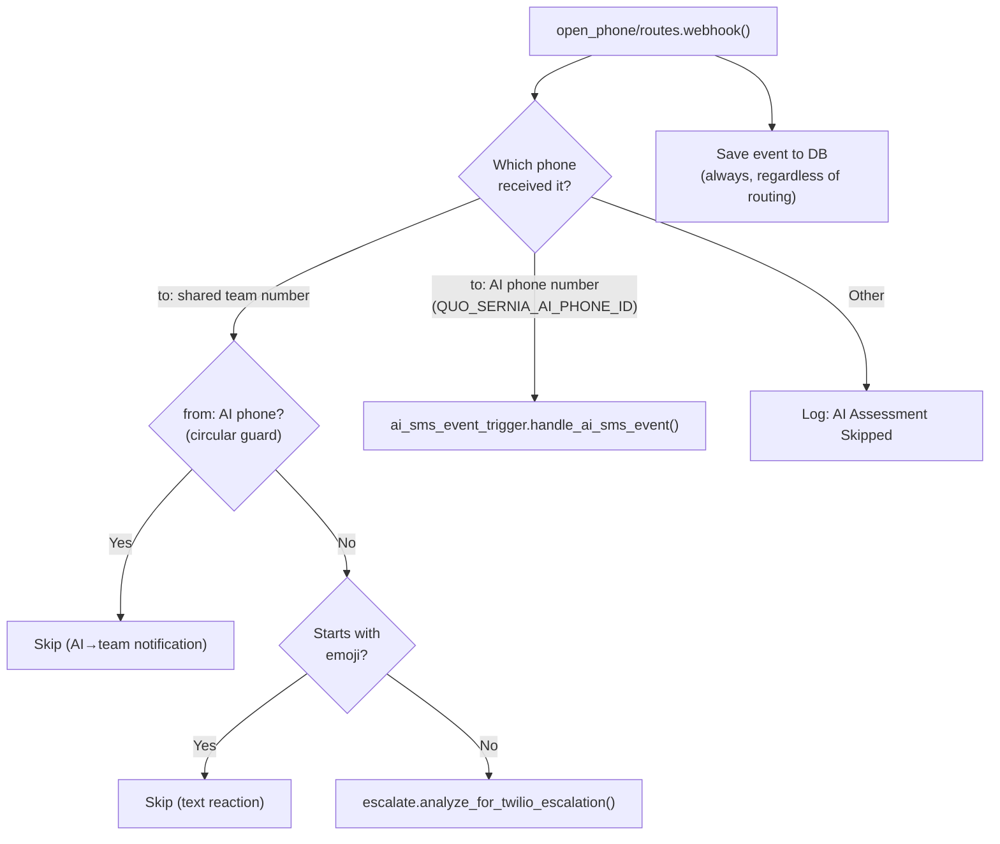
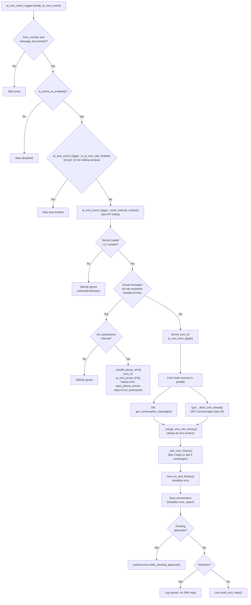
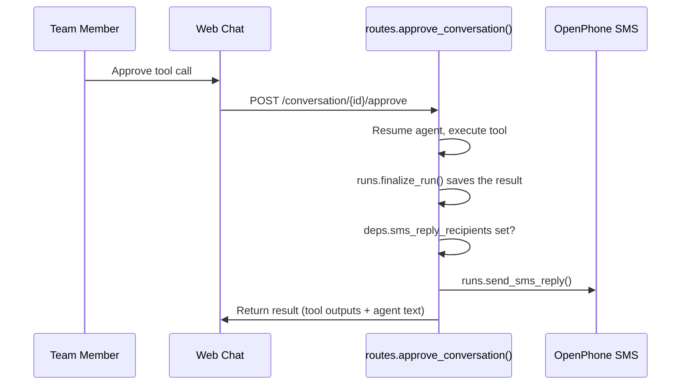
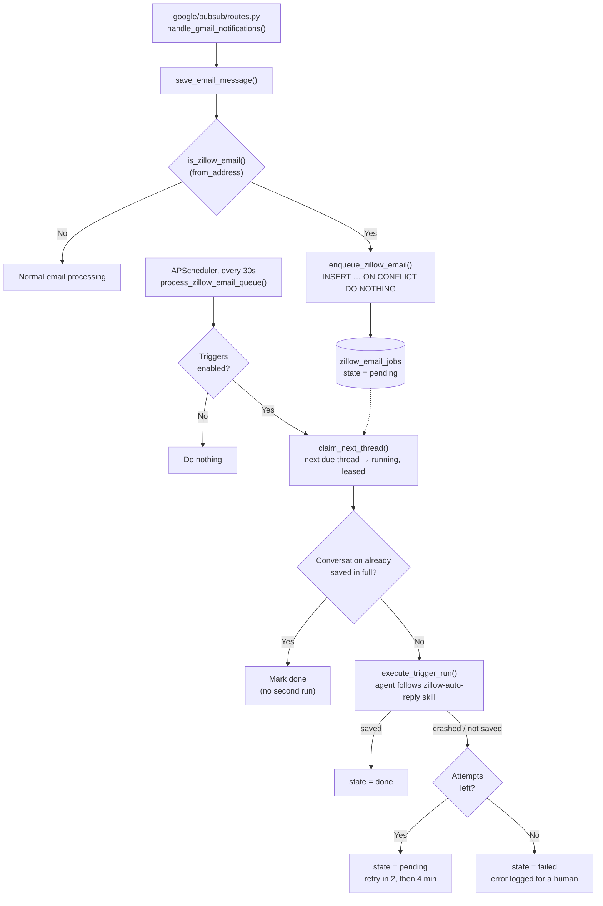

| `zillow_email_event_trigger.py` | Zillow email queue: idempotent enqueue from Pub/Sub, leased per-thread claims, retry/expiry, and the scheduled worker that runs the agent |
# Triggers

Event-driven background processing for the Sernia AI agent. Triggers run the agent outside of an HTTP request context — no Clerk user, no streaming — and create web chat conversations when human attention is needed.

## SMS Handling

The OpenPhone webhook routes inbound SMS based on which phone number received the message:

| Phone Number | Handler | Purpose |
|-------------|---------|---------|
| AI's direct line (`QUO_SERNIA_AI_PHONE_ID`) | `ai_sms_event_trigger.py` | Direct conversation — AI responds natively via SMS |
| Shared team number | Twilio escalation only | `analyze_for_twilio_escalation()` — no AI agent run |

> **Note:** The team SMS event trigger (`team_sms_event_trigger.py`) was removed — it fired too many agent runs (214 events) for marginal value. Team SMS ClickUp task creation will be folded into the scheduled check at a later date.

### Webhook Routing



## AI SMS Event Trigger Flow

The AI SMS event trigger treats the SMS thread as a direct conversation. Only internal contacts (Sernia Capital LLC) are allowed. The agent responds natively via SMS.

### Group Threads

A `message.received` on the AI line whose webhook `to` field contains recipients **besides the AI's own number** is a **group text** (`_extract_group_participants` — the AI's E.164 number comes from the process-cached `open_phone.service.get_ai_phone_number()`; if that lookup fails, the trigger safely falls back to 1:1 handling). Group messages take a parallel path (`_handle_group_sms`) that differs from the 1:1 flow in four ways:

1. **Gate** — *every* human participant (sender + other recipients) must be an internal contact. One external/unknown member and the whole event is silently ignored.
2. **Conversation key** — `ai_sms_group_{CN...}` (the Quo conversation ID), so all group members share **one** AI conversation, instead of the sender's personal `ai_sms_from_{digits}`.
3. **History** — reconstructed from the local `open_phone_events` webhook table (the only source of full group history — OpenPhone's API can't list group messages by participant filter), merged with DB history. Inbound turns are prefixed `[Sender Name]:` so the agent can tell members apart; the same prefix format is used for the live prompt so text-dedup in the merge works. The current message is excluded from reconstruction (the webhook saves it to the events table *before* the background task runs) since it becomes the run's prompt.
4. **Reply** — sent to **all** human participants in one API call (`to` array), landing in the same group thread. Post-approval replies do the same: `routes.approve_conversation()` reads the conversation's `trigger_group_participants` metadata into `deps.sms_reply_recipients`, and the shared pipeline replies to the group instead of 1:1.

`send_sms`'s hidden-context seeding for group sends targets the same `ai_sms_group_{CN...}` conversation (looked up via `_find_group_conversation` after the send), so the agent has the context when any member replies.

### History Loading

The trigger always fetches from **both** sources and merges them:

1. **DB history** — `get_conversation_messages()` preserves full tool call context from prior agent runs
2. **Quo SMS thread** — `_fetch_sms_thread()` via `GET /v1/messages` captures messages sent from any conversation (e.g. web chat tool calls, context-seeded messages)

`_merge_sms_into_history()` deduplicates by text content — any SMS messages whose text is missing from DB history are prepended. After merging, `_trim_sms_history()` reduces the history to the last `SMS_HISTORY_MIN_DAYS` days or last `SMS_HISTORY_MIN_MESSAGES` user exchanges, whichever window goes further back. This significantly reduces token usage for long-running SMS conversations. When history is trimmed, a system hint tells the agent how many messages were omitted and which tools to use for earlier context (`db_get_contact_sms_history`, `db_search_sms_history`). If both sources return empty (e.g. Quo API hasn't indexed recent messages yet), a hint is injected telling the agent to use `db_get_contact_sms_history`.



### Post-Approval SMS Reply

When a team member approves an action in web chat for an AI SMS conversation, the approval endpoint detects `modality="sms"` and sends the agent's result back via SMS:



## Zillow Email Event Trigger Flow

Zillow lead processing through a **durable queue**. When an email from `zillow.com` arrives via Gmail Pub/Sub, a row is written to the `zillow_email_jobs` table. A scheduled worker (every 30 seconds) picks up due jobs, groups them by lead thread, and runs the agent **once per thread**.

The agent loads the `zillow-auto-reply` workspace skill and replies via `send_email`. By default, every outbound reply pauses for the standard external-email HITL approval card. Both the debounce length and the HITL gate are runtime-configurable via the **Zillow Email Auto-Reply** section of the Settings page (`/sernia-settings`), backed by the `zillow_email_config` AppSetting:

```json
{
  "debounce_seconds": 300,
  "require_approval": true
}
```

Turning `require_approval` off lets the agent auto-send Zillow replies without the HITL prompt — intended only after the agent has earned trust on this flow. Flip it back on if the agent goes off the rails.



### Job lifecycle

| State | Meaning |
|-------|---------|
| `pending` | Waiting for its debounce window or retry delay (`next_attempt_at`). |
| `running` | Claimed by a worker under a 30-minute lease (`lease_token`, `lease_until`). `conversation_id` is set from the first claim on. |
| `done` | The run was saved; `conversation_id` links to it. |
| `failed` | Three attempts used. Nothing retries it; an error-level log names the emails. |
| `expired` | The email was more than 24 hours old before it could be processed. |

### Key design choices

- **Recorded before anything else** — the row is committed inside the Pub/Sub handler. A deploy or crash afterwards loses nothing; the worker resumes from the table. (The previous version kept arriving emails in process memory for the debounce window and lost them on restart.)
- **Idempotent enqueue** — `message_id` is unique, so a Pub/Sub redelivery or a Gmail label-change notification for an email already seen inserts nothing. The webhook therefore enqueues on every notification without deciding whether the email is "new". The email is queued *before* it is counted as processed, so if the insert fails the webhook answers non-2xx and Pub/Sub delivers it again — a lead is never acknowledged without being in the queue.
- **Freshness limit** — emails older than 24 hours are not queued, and queued jobs expire at that age. This bounds the backlog after an outage and makes label changes on old emails harmless.
- **One run per lead thread, one at a time** — the first email in a thread starts that thread's debounce window (`zillow_email_config.debounce_seconds`); further emails in the same thread before it fires ride along. A thread with a run in progress (a live lease) is not claimable at all: an email that arrives mid-run stays `pending` and gets its own run afterwards. Two runs on one lead at once could send conflicting replies.
- **Leases, not locks held open** — a claim marks rows `running` with a lease. If the worker dies, the lease runs out and the rows become claimable again. Results are written only where `lease_token` still matches, so a worker that outlived its lease cannot overwrite the next owner. Claims are serialized by a Postgres advisory lock so two workers cannot split one thread.
- **Batches are fixed at first claim** — the jobs claimed together are a *batch*, and the batch is given its conversation ID (`zillow-{thread_id}-{last job id}`) then, stored on its rows. A later email in the thread never joins a batch that is being retried; it forms the next batch. This is what keeps a retry pointed at the same conversation, and it means each batch counts its own attempts.
- **At-least-once, made safe** — the same emails can be handed to the agent twice (a run that crashed part-way, or a crash between "saved" and "marked done"). Three things keep a lead from getting two replies:
  1. a retry reuses the batch's conversation ID, so it overwrites rather than adds a second conversation;
  2. a batch whose conversation was already saved in full is marked done without running again;
  3. **an automatic send happens at most once per original message.** With approval off, `send_email` reserves the send in the `auto_approved_sends` table (keyed on the original email's RFC `Message-ID`) *before* sending. A retried run that reaches `send_email` again finds the reservation and pauses for human approval instead. The reservation is deliberately not released if the send fails: a possibly-missing automatic reply is the price of never sending two.
- **Retries with backoff, then stop** — a crashed or unsaved run goes back to `pending` (2 minutes, then 4). After three attempts it is parked as `failed` with an error-level log.
- **No email content in the table** — a job holds IDs, subject and sender only. The agent reads the email from Gmail when it runs.
- **Per-trigger HITL toggle, scoped to the lead** — `zillow_email_config.require_approval` controls whether outbound Zillow replies pause for the external-email HITL approval card. When the toggle is off, the worker passes `auto_approved_reply_domains={"zillow.com"}`, which sets it on `SerniaDeps`; `send_email` then skips its approval gate only for a **threaded reply whose every recipient is a Zillow relay address** (`google_tools.is_auto_approved_reply`), and only after `reply_to_message_id` has resolved to real threading headers in Gmail — a stale or made-up ID, or a failed lookup, falls back to the approval card instead of sending a new thread unreviewed. Email to any other external address, or a new unthreaded email, still pauses for approval in the same run. The scope is narrow on purpose: these runs read email written by strangers, so text inside a lead's message must not be able to redirect an auto-send. Other triggers (and web chat) never set the scope, so the standard HITL behavior is preserved everywhere else.
- **Shared-mailbox IDs in the prompt** — a job holds the Gmail IDs of the watched mailbox, but the agent reads and replies in the shared one, where the same email has different IDs. Before each run the worker looks up the shared copy by RFC `Message-ID` ([`zillow_leads/thread.py`](../zillow_leads/README.md)) and gives the agent those IDs, so its first read succeeds and the reply threads in the shared mailbox. An email with no shared copy keeps its original ID and the prompt names the mailbox it belongs to. A Gmail error during the lookup fails the batch, which is retried.
- **One sender check** — `is_zillow_email()` parses the `From` header and matches the address's domain (`zillow.com` or a subdomain). The Pub/Sub route calls it rather than testing for a substring, which would also accept `"noreply@zillow.com" <someone@elsewhere.com>`.
- **Trigger instructions stay lean** — the prompt points to the `zillow-auto-reply` skill for detailed guidance (qualification criteria, availability schedule, response tone). This allows iterating on AI behavior without code deploys.
- **No completion push** — Zillow drafts (and other trigger completions) do not fire push notifications. Only HITL approval prompts (`notify_pending_approval`) push. Drafts surface via the web-chat conversation list to keep notification volume low.
- **Coexists with scheduled check** — `run_scheduled_checks()` still runs as a safety net.

### Inspecting the queue

```sql
-- What is waiting, running, or stuck
SELECT state, count(*), min(created_at), max(created_at)
FROM zillow_email_jobs GROUP BY state;

-- Jobs that need a human
SELECT message_id, thread_id, subject, attempts, last_error
FROM zillow_email_jobs WHERE state = 'failed' ORDER BY created_at DESC;
```

To retry a parked job after fixing the cause, set it back to waiting:
`UPDATE zillow_email_jobs SET state = 'pending', attempts = 0, next_attempt_at = now(), expires_at = now() + interval '24 hours' WHERE message_id = '…';`

## Scheduled Trigger Flow

A single scheduled job via APScheduler in `scheduled_triggers.py`:

| Job | Interval | Scope |
|-----|----------|-------|
| `run_scheduled_checks()` | Configurable (default: Mon–Fri at 8am, 11am, 2pm, 5pm ET) | All inbox checks — agent follows the `scheduled-checks` skill |

The schedule is configurable via the Settings page (`/sernia-settings`) or the `schedule_config` key in `app_settings`. The DB-backed config stores `days_of_week` (0=Mon … 6=Sun) and `hours` (ET, 24-hour). Changes take effect immediately — the APScheduler job is re-registered on save. Setting either list to empty unregisters the job entirely (no scheduled checks).

The trigger is a thin function that points the agent to the `scheduled-checks` workspace skill. All domain logic (what to check, how to assess, output rules) lives in `.claude/skills/scheduled-checks/SKILL.md`, not in trigger code.

Uses `background_agent_runner.run_agent_for_trigger()` with the silent/alert pattern. When the agent uses the `NoAction` structured output, the shared pipeline persists the conversation but delivers nothing.

## Universal Kill Switch (`is_sernia_ai_enabled`)

The `triggers_enabled` app setting in the DB acts as a universal kill switch for all **automated** agent runs. It prevents triggers from firing in lower environments (dev, PR envs) where webhooks or schedulers might still deliver events.

| Path | Gated? | Why |
|------|--------|-----|
| AI SMS event trigger | Yes | Automated — webhook-driven |
| Zillow email queue | Yes | Automated — nothing is queued and the worker does nothing while disabled |
| Scheduled checks | Yes | Automated — scheduler-driven (email + SMS inbox checks) |
| Web chat (`/chat`) | **No** | User-initiated, intentional |
| HITL approvals (`/approve`) | **No** | User-initiated, write actions already behind HITL |

**Default**: Enabled on production, disabled elsewhere. Non-production environments (dev, PR envs) are **hard-gated off** — the DB `triggers_enabled` row is ignored and the function always returns False. This is important because Neon PR branches inherit the parent DB's rows, so the `triggers_enabled` value in a PR env reflects production's intent, not the PR's. On production, the DB row acts as the runtime kill switch: missing row = enabled, explicit `false` = disabled.

The admin settings GET endpoint mirrors the same behavior — on non-production it returns `triggers_enabled: false` and `schedule_config: {days_of_week: [], hours: []}` regardless of what the DB contains. The `model_config` row is **not** hard-gated off on non-prod — PR envs should run whichever model production has configured so trigger behavior stays representative.

The scheduled-checks job itself is only registered on production and only when both `days_of_week` and `hours` are non-empty. Empty lists (or any non-production env) remove the job entirely.

**Implementation**: `is_sernia_ai_enabled()` in `sernia_ai/models.py` — shared by `background_agent_runner.py` and `ai_sms_event_trigger.py`. Job registration in `scheduled_triggers._apply_schedule()`.

## Rate Limiting

### Background agent runner

Shared in-memory rate limiter in `background_agent_runner.py`:

- **Cooldown**: 2 minutes per key (the Zillow queue does not go through this limiter; its debounce window and one-run-per-thread claim are its throttle)
- **Key format**: `{trigger_source}:{rate_limit_key}` (e.g., `ai_sms:+14155550100`)
- **Scope**: Per-process, resets on restart
- **Behavior**: First call within window proceeds, subsequent calls are logged and skipped

### AI SMS event trigger

Separate sliding-window rate limiter in `ai_sms_event_trigger.py`:

- **Window**: 10 minutes
- **Max calls**: 10 per phone number per window
- **Scope**: Per-process, resets on restart
- **Behavior**: Allows burst traffic up to the limit, then blocks until older timestamps fall outside the window

## Files

| File | Purpose |
|------|---------|
| `background_agent_runner.py` | Trigger gate: triggers-enabled check, rate limiting, deps; then hands the run to the shared pipeline (`../runs.py`) |
| `../runs.py` | Shared run pipeline used by every entry point: agent run, workspace sync, save, `NoAction` handling, HITL approval push (`notify_pending_approval` only for triggers — generic completion alerts removed), SMS reply |
| `zillow_email_event_trigger.py` | Zillow email event trigger: real-time draft generation when Zillow emails arrive via Pub/Sub, Emilio-only push notification |
| `ai_sms_event_trigger.py` | AI SMS event trigger: contact gate, history loading/bootstrap, then `run_and_finalize` with `modality="sms"` (the pipeline sends the SMS reply). Group messages (`to` beyond the AI line) run `_handle_group_sms`: all-internal gate, `ai_sms_group_{CN}` conversation, verified API history with webhook fallback, reply to all participants |
| `scheduled_triggers.py` | Single scheduled trigger + APScheduler registration: `run_scheduled_checks()` |

## Config (`config.py`)

| Constant | Purpose |
|----------|---------|
| `TRIGGER_BOT_ID` | `"system:sernia-ai"` — clerk_user_id for agent-initiated conversations |
| `TRIGGER_BOT_NAME` | `"Sernia AI (Trigger)"` — display name |
| `QUO_SERNIA_AI_PHONE_ID` | AI's phone line (used for SMS replies and team notifications) |
| `QUO_INTERNAL_COMPANY` | `"Sernia Capital LLC"` — gate for AI SMS contact verification |
| `SMS_CONVERSATION_MAX_MESSAGES` | Max messages to fetch from OpenPhone for SMS conversation bootstrap (20) |
| `SMS_HISTORY_MIN_DAYS` | History trimming: minimum days of history to keep (3) |
| `SMS_HISTORY_MIN_MESSAGES` | History trimming: minimum user-message turns to keep (3) |
| `DEFAULT_SCHEDULE_DAYS_OF_WEEK` | Default days (Mon–Fri) — overridden by `schedule_config` DB setting |
| `DEFAULT_SCHEDULE_HOURS` | Default hours (`[8,11,14,17]` ET) — overridden by `schedule_config` DB setting |
| `EMILIO_CONTACT_SLUG` | `"emilio"` — contact slug used to look up Emilio's `clerk_user_id` from DB (contacts → users join) |

### Fixed reminder tool availability

Triggered runs can use `list_message_templates` / `send_templated_message` for
code-approved reminders without modifying any approval-bypass dependency flags.
This does not create a scheduled lease-reminder campaign. See
[usage, eligibility, and retry limits](../messaging/README.md).

### SMS delivery reliability (September 2026)

Webhook routing enqueues effects only after the unique event row commits; a replay
or concurrent duplicate returns without scheduling another run. SMS turns within
the same process are serialized by Quo conversation ID through final delivery,
preventing a second inbound text from loading the first run's unfinished history.
The process lock is not a distributed queue or a durable retry mechanism.

Only the final response sends to `sms_reply_recipients` (including approval resumes).
Group bootstrap reads the current Quo group messages API, validates conversation IDs,
and falls back to webhook history. See [Quo tool behavior](../tools/README.md).
