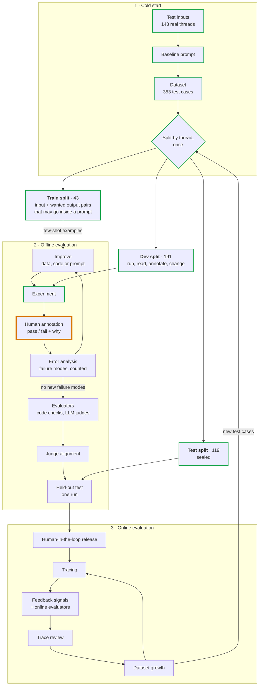

# How the reply decision is evaluated

The method this package follows, the name the field gives each part, and where
we are in it. [README.md](README.md) describes the system; this describes the
method. An interactive version, with an example for every stage, is at
[eesposito.com/systems/leasing-evals](https://eesposito.com/systems/leasing-evals).

## Process overview

A green outline marks a finished stage; orange marks the current one.

The whiteboard version:

| Phase | What happens |
|---|---|
| Cold start | inputs → baseline prompt → dataset → split into train, dev, test |
| Offline | on dev: experiment → annotate → error analysis → improve, repeated. Then evaluators → judge alignment → one run on test |
| Online | release behind approval, then tracing → feedback and online evaluators → trace review → dataset growth, repeated. New test cases flow back to offline |

## Terms

The field has not settled on one vocabulary. The first column is the name used
most often; the second lists others for the same thing.

| Term | Also called | Here |
|---|---|---|
| Test case | task, example | A scenario: one thread, cut at a moment a response was owed |
| Dataset | eval set; golden dataset once it has reference outputs | 353 scenarios from 143 threads |
| Reference output | golden answer, expected output, ground truth | The reply a person would send. Optional; added during annotation |
| Train split | few-shot examples, training set | 43 scenarios |
| Dev split | validation set, development set | 191 scenarios |
| Test split | held-out set, holdout | 119 scenarios |
| Experiment | eval run | One policy version run over a sample |
| Trace | transcript, trajectory | The full record of one model run |
| Human annotation | labeling, human review | Pass or fail plus one line, on the review page |
| Error analysis | failure analysis; open coding then axial coding | Grouping fail notes into failure modes |
| Failure mode | failure type; the full list is a failure taxonomy | Not known yet |
| Evaluator | grader, scorer, metric | `ReplyChecks` and, later, judges |
| Code evaluator | assertion, code-based grader | Four today |
| LLM judge | LLM-as-judge, model-based grader | None yet |
| Judge alignment | calibration, validating the judge | Not started |
| Offline evaluation | pre-deployment evaluation | Everything so far |
| Online evaluation | post-deployment evaluation, production monitoring | Planned |
| Guardrail | inline check | An evaluator that blocks a send, not just scores it |
| Human-in-the-loop | HITL, approval gate | The existing approval step |
| Regression suite | regression tests, CI evals | Planned, on synthetic cases |

## 1. Cold start

This phase starts with no outputs and no labels. The sources describe it
without agreeing on a name.

- **Test inputs.** Use real history when it exists; it carries the real mix of
  easy and odd cases. With none, generate synthetic inputs: name the dimensions
  that vary, write combinations by hand, have a model turn each into a message.
  Synthetic data finds failures but cannot say how common they are. We had 143
  real threads.
- **Baseline prompt.** A first version written to have outputs to read. Ours is
  `policy.md`, rewritten from the old workspace skill.
- **Dataset.** Each thread is cut at every point where the lead spoke last and
  a response was owed. Past replies are kept for the reviewer to see and are
  not treated as correct.
- **Split.** Done before reading any results; see the next section.

## The three splits

| Split | What is in it | Who looks, and when |
|---|---|---|
| **Train** | Worked examples that may be pasted into a prompt. Each is an input paired with the output we want: for the policy, a case and the reply a person would send; for an LLM judge, a reply with its verdict and reason. Nothing is trained; the name is inherited from machine learning | Anyone, any time. An example inside a prompt can no longer test that prompt |
| **Dev** | The cases all iteration happens on | Anyone, as often as needed. Its score drifts upward as changes fit it |
| **Test** | Cases no change has been fitted to | Nobody until a version is believed finished, then one run |

- **Split by thread.** A later scenario in a thread contains the earlier ones.
- **Assign before looking.** Threads that had already been run were forced into
  dev.
- **Test is used once.** After a test result informs a change, those threads
  count as dev, and new production cases refill the unseen pool.
- **Two things get split.** Scenarios are split to tune the policy. Later, the
  annotations made on dev are split again, the same three ways, to tune a
  judge. The published guidance (10 to 20% train, the rest evenly dev and test,
  per Husain and Shankar; 75% dev and 25% test, per Yan) is about the second.
  Using the same split for the first is this project's extension of that
  reasoning.
- **The test threads are not entirely unseen.** Before the split existed,
  every thread was read in aggregate twice: to count what leads ask about, and
  to copy unit facts out of our own past replies. No decision has been run on
  a test thread.

## 2. Offline evaluation

**Experiment.** One fixed version run over dev cases, stored with the policy
commit, the model and a hash of the operating data.

**Human annotation.** One person who knows the business marks each decision:

- Pass or fail. The verdict is binary because the difference between a 3 and
  a 4 on a five-point scale is subjective and inconsistent.
- One line on why, written so a new hire would understand it.
- Optionally, the reply they would have sent. It is one acceptable answer
  among several, so it serves as an example and is not an exact target.

No rubric and no reference outputs are needed first. The criteria come out of
reading real outputs.

**Error analysis.** Name each failure (open coding), merge the names into a few
failure modes (axial coding), count them. Fix the largest in the layer that
owns it: operating data for a missing fact, code for an exact rule, the policy
for judgement. Start with about 30 annotations, go toward 100, stop when new
ones reveal no new failure modes.

**Improve.** What gets changed is most often the prompt: the system prompt or
skill, and any few-shot examples in it. But anything that shapes the output can
be the fix: the context the prompt is built from, tool definitions and their
descriptions, the output schema, the model and its settings, or the code around
the call. Error analysis indicates which one. Here the first improvement was
to context (unit fact sheets), not to the prompt.

**Evaluators.** Each stable failure mode gets an automatic check: code where
the rule has an exact answer, an LLM judge where it takes judgement, one judge
per failure mode answering one yes-or-no question.

**Judge alignment.** A judge is trusted only after its verdicts are compared
with human annotations it has not seen, reporting how many real fails it
catches (true positive rate) and how many good outputs it passes (true negative
rate).

**Held-out test.** The frozen version runs once on the test split. If the
result is used to tune the system, the test split has become part of dev.

## 3. Online evaluation

- **Human-in-the-loop release.** Every reply waits for approval at first.
- **Tracing.** Every run is recorded in full, which the application already
  does.
- **Feedback signals.** An approval is an annotation: sent unchanged is a pass,
  edited is a fail with a reference output attached, rejected is a fail.
- **Online evaluators.** The same checks, on live traces. A check that must
  stop a send is a guardrail.
- **Trace review.** Error analysis applied to a weekly sample of production
  traces, always including some at random.
- **Dataset growth.** Each failure becomes a test case; fixed ones stay in a
  regression suite that runs on every change.

## Log

| Experiment | Change before it | Sample | Reply / quiet / escalate | Annotated |
|---|---|---|---|---|
| 1 | Baseline prompt. Listings had rent and lease dates only | 30 | 12 / 6 / 12 | No |
| 2 | Fact sheets and standard answers added to operating data | same 30 | 20 / 5 / 5 | In progress |

Experiment 1 was never annotated. The change before experiment 2 was chosen
from the model's own escalation questions, which asked for facts the case
lacked. That is a fair reason to fix the data, but it is not a human judgement
of quality: experiment 2 is the first with annotations, and so the baseline.

The split was made after experiment 2. Its 30 scenarios are all in dev.

## Sources

- Hamel Husain and Shreya Shankar, [AI Evals: Everything You Need to Know](https://hamel.dev/blog/posts/evals-faq/):
  error analysis, binary annotations, synthetic data, the train / dev / test
  split for a judge, offline and online evals, guardrails.
- Hamel Husain, [Using LLM-as-a-Judge](https://hamel.dev/blog/posts/llm-judge/):
  one domain expert, a written critique with every verdict, true positive and
  true negative rates.
- Eugene Yan, [Product Evals in Three Simple Steps](https://eugeneyan.com/writing/product-evals/):
  label, align the evaluator on dev and check it on test, one evaluator per
  dimension.
- Anthropic, [Demystifying evals for AI agents](https://www.anthropic.com/engineering/demystifying-evals-for-ai-agents):
  tasks, trials, graders and transcripts; capability evals that graduate into
  a regression suite.
- LangSmith, [Evaluation concepts](https://docs.langchain.com/langsmith/evaluation-concepts):
  dataset, example, experiment, evaluator, reference output; how offline and
  online evaluation feed each other.
- OpenAI, [Evaluation best practices](https://developers.openai.com/api/docs/guides/evaluation-best-practices):
  where eval data comes from, calibrating automatic scoring against people,
  evaluating on every change.
