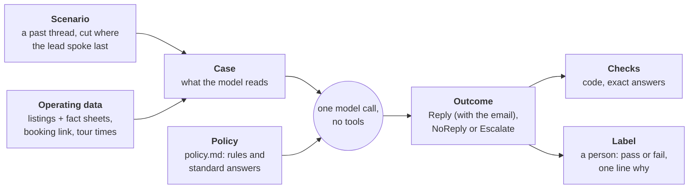
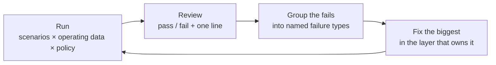
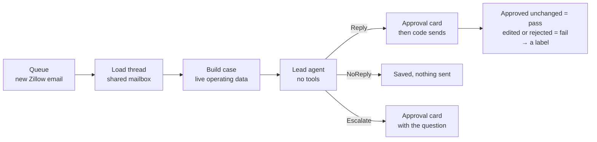

# Zillow lead replies

When a Zillow lead emails, one decision is owed: **reply** (with what), **stay
quiet**, or **hand it to a person**. This package makes that decision a single
step that can be replayed on past emails and scored, so it is improved by
measurement instead of by reading production conversations.

## Layout

Three kinds of file live here, kept apart:

```
zillow_leads/
├── README.md        this file
├── agent.py         the lead agent and its three outcome types
├── case.py          builds the case the agent reads
├── thread.py        loads a lead's email thread
├── handle.py        saves an outcome for approval, sends on approval
├── skill.py         the policy as a skill for the general agent
├── prompts/         text a model reads at runtime
│   ├── role.md      lead agent only: who it is, what it is given
│   ├── policy.md    the rules; both agents read this
│   └── record.md    lead agent only: how to fill in its output
└── evals/           offline only; the running service imports nothing from it
    ├── README.md    the method, the terms and the experiment log
    ├── scenarios.py scenarios and the train / dev / test split
    ├── checks.py    rules code can check exactly
    ├── labels.py    a person's verdict on one output
    ├── pages.py     builds the review page and the dataset page
    ├── templates/   review.html, dataset.html
    └── cli.py       the commands
```

| Kind | Where | A change here |
|---|---|---|
| Runtime code | `*.py` at the top level | Changes what production does |
| Runtime prompts | `prompts/` | Changes what the model is told, so it also changes behaviour. Run an experiment before merging |
| Offline eval tooling | `evals/` | Changes how outputs are measured and reviewed, never what is sent |
| Documentation | `README.md` here and in `evals/` | Changes nothing at runtime |

## Overview



| Word | Meaning | Changes when |
|---|---|---|
| **Scenario** | A real conversation up to a moment where we owed a response, containing only the emails. | Never; it is a record of what happened. |
| **Operating data** | What was true of the business then: units, facts about each, the booking link, when tours can happen. | Weekly in season, and its format can change too. |
| **Case** | Scenario + operating data, rendered as text; this is the model's whole input. | Rebuilt on every run. |
| **Policy** | The instructions: when to reply, what is allowed, how to write, and the answers that are the same for every lead (how to apply, the fee). | By commit, after an eval run says the change helps. |
| **Outcome** | What the lead agent returns: a `Reply` with the full email, a `NoReply`, or an `Escalate` with a question. Three types, so a reply cannot exist without its text. | Every run. |
| **Check** | A rule with an exact answer, written as code. | Rarely. |
| **Label** | A person's verdict on one decision, tied to the scenario. | Added each review round. |

Scenarios and labels are kept permanently. Everything between them can change:
listings can move from a notes file to a database, or tour times from a weekly
pattern to a booking service, and the same scenarios and labels still measure
whether replies got better or worse.

## One example, start to finish

**Scenario** (stored once, never edited)

> Monday 9:00 AM, lead: "Hi, I'd like to see 12 Example St #A this week. Does
> it have a dishwasher?"

**Operating data** (one file for the season)

```json
{
  "listings": [{
    "unit": "12-A", "address": "12 Example St #A", "rent": 1500,
    "lease_start_earliest": "2026-07-01",
    "facts": "1 bedroom, second floor\nDishwasher\nTenant pays gas and electric"
  }],
  "availability": [{"agent": "Alex", "weekday_times": ["10:00", "17:30"]}]
}
```

**Case** (built by code; this text is all the model sees)

```
Current time: Monday, May 4, 2026 at 9:05 AM (America/New_York)

## Listings
- 12-A: 12 Example St #A; $1,500/month; lease starts July 1, 2026; in-person tours only
  - 1 bedroom, second floor
  - Dishwasher
  - Tenant pays gas and electric

## Booking links
- (none)

## Tour times that may be offered
- Tuesday, May 5: 10:00 AM, 5:30 PM
- Wednesday, May 6: 10:00 AM, 5:30 PM

## Thread (oldest first)
### Message 1: Lead, Monday, May 4 at 9:00 AM
Hi, I'd like to see 12 Example St #A this week. Does it have a dishwasher?
```

Code already removed Monday's times (24-hour notice) and the agent's name.

**Outcome** (from the lead agent; this one is a `Reply`)

```json
{
  "action": "reply",
  "reason": "New lead asking for a tour and one question the fact sheet answers.",
  "reply_body": "Hello, yes, the apartment has a dishwasher. We can show it at: ...",
  "offered_slots": ["2026-05-05T10:00-04:00", "2026-05-05T17:30-04:00", "..."],
  "lead": {"unit": "12-A"},
  "tour": {"status": "proposed"}
}
```

**Checks** (code): offered times are all on the list ✓ · signature present ✓ ·
no staff names ✓ · no em-dash ✓

**Label** (you): `fail`, "answered the question but buried it under four tour
times; lead with the answer."

Grouping thirty labels like that one shows which failure is most common and
which layer it belongs to.

## The loop

The method in full, with the data splits and the sources it follows, is in
[evals/README.md](evals/README.md).



| A failure like | Is fixed in | Not in |
|---|---|---|
| "Didn't know the unit has parking" | Operating data: the unit's fact sheet | the prompt |
| "Offered a time inside the notice period" | Code: slot arithmetic | the prompt |
| "Tone too stiff", "replied when it should have waited" | Policy: `prompts/policy.md` | code |
| "Asked for a discount" | Nowhere; escalating is the correct outcome | |

Nine experiments so far, all on the same 30 real scenarios. The first five:

| Experiment | Operating data | Reply | No reply | Escalate |
|---|---|---|---|---|
| 1 | rent and lease dates only | 12 | 6 | 12 |
| 2 | + fact sheets and standard answers | 20 | 5 | 5 |
| 3 | same data; policy checked against the original skill | 19 | 5 | 6 |
| 4 | + a booking link; tours offered through it by default | 20 | 4 | 6 |
| 5 | standard answers moved from the data into the policy | 19 | 4 | 7 |

The policy barely changed between the first two. Most escalations in the first
were requests for facts the case did not contain, which became clear from
running the cases.

## What a listing needs

From this season's 353 decision points: about 9 in 10 first messages ask for a
tour, most follow-ups are tour logistics or a plain "thanks", and roughly 1 in
10 messages asks something about the unit or about applying.

**Typed fields**: only what code or a check reads.

| Field | Used for |
|---|---|
| `unit`, `address` | Matching the inquiry to a listing |
| `rent` | Stated in replies; a future exact check |
| `lease_start_earliest`, `lease_start_latest` | Move-in fit |
| `virtual_tours` | Which virtual-tour answer applies |
| `rented_on` | Dropping the unit from offers from that date |

**`facts`**: free text, one fact per line. In order of how often leads ask:
bedrooms and layout, floor, pets, utilities (included / tenant pays), lease
length, laundry, dishwasher and air conditioning, parking, deposit, outdoor
space, furnished or not. Add a line whenever an escalation shows one missing.

Answers that are the same for every unit are not listing data. How to apply,
the fee, who must apply, how long review takes and what holds a unit after
approval are in `prompts/policy.md` under "Standard answers". The case holds only what
differs from one lead or one week to the next.

Exceptions are deliberately left out of both, for example a discount, an
unusual lease length, or an applicant without a credit file. The agent
escalates those.

**`booking_url`**: where a lead can book a showing themselves, one for the
business or one per listing. When a unit has one, a reply to a lead with no
stated preference gives the link and lists no times. Times are still offered
when a tour is already booked for the unit (so leads share a showing) or when
the lead named a day or time.

Tour times follow the same approach. Today a weekly pattern per person is turned into
slots by `offerable_slots()`. A calendar or booking service can supply the
slots instead (`build_case(..., slots=...)`); the case stores the times, never
their source. This was tested once and is not built: the existing service
account can read free/busy for a domain user's calendar and for an outside
calendar shared with that user. A calendar that is not shared comes back as an
error, which must be read as "unknown", never as "free".

## Running it

```bash
# Once per season: cut past threads into scenarios (applicant emails: keep outside the repo)
uv run python -m api.src.sernia_ai.zillow_leads.evals export \
    --after 2026-04-01 --before 2026-08-01 --out <private>/scenarios.jsonl

# Once per season: assign each thread to train, dev or test
uv run python -m api.src.sernia_ai.zillow_leads.evals split \
    --scenarios <private>/scenarios.jsonl --out <private>/splits.json

# Any time: write a page for reading the train and dev splits (test stays sealed)
uv run python -m api.src.sernia_ai.zillow_leads.evals browse \
    --scenarios <private>/scenarios.jsonl --splits <private>/splits.json \
    --run <private>/runs/round-3.jsonl --review <private>/review.html \
    --out <private>/dataset.html

# Each experiment: run a dev sample and send it to Logfire
uv run python -m api.src.sernia_ai.zillow_leads.evals run \
    --scenarios <private>/scenarios.jsonl --operating <private>/operating.json \
    --splits <private>/splits.json --split dev \
    --name round-3 --sample 30 --seed 7 --out <private>/runs/round-3.jsonl

# Then: write the page you label that run on, and open it in a browser.
# Keep --out the same every time, so there is one review page to bookmark.
uv run python -m api.src.sernia_ai.zillow_leads.evals review \
    --scenarios <private>/scenarios.jsonl --operating <private>/operating.json \
    --run <private>/runs/round-3.jsonl --out <private>/review.html
```

`run` saves the policy as it was beside its output (`round-3.policy.md`), and
the review page shows it behind a **Policy** button.

The review page shows, per decision: what the lead wrote, what the model
decided and drafted, and (folded away) everything the model was given and what
we really sent at the time. Mark pass or fail and write one line on why. Labels
are kept in the browser as you go; **Download labels** saves them as
`<run>-labels.json`, one row per scenario:

```json
{"scenario_id": "…", "verdict": "fail", "note": "buried the answer under the tour times",
 "corrected_reply": "", "action": "reply", "output_hash": "…", "run": "round-3"}
```

`corrected_reply` is optional: the reply you would have sent.

A label belongs to the output it judged. The model words the same decision
differently on every run, so after a re-run the page does not reuse a verdict
silently. It shows "On an earlier draft you marked this fail: …" with a **Still
applies** button, and counts the case as unlabelled until you confirm or decide
again. To start a page from labels made elsewhere, pass `--labels <file>`; to
let it recognise labels made on earlier runs, pass `--previous <run.jsonl>`.

The lead agent has its own model setting, `LEAD_AGENT_MODEL` in `agent.py`,
separate from the general agent's. `run --model <name>` tries another model on
the same cases without editing code.

A run records the policy commit, the model, and a hash of the operating file,
prints counts only, and appears in Logfire under AI Evaluations. The same
`--seed` picks the same scenarios, so experiments can be compared on the same
cases.

Real scenarios, review pages, labels and the season's operating file hold
applicant emails and business details. They stay out of Git and out of CI. A
small synthetic set will live in the repo for CI.

## In production



The queue hands every Zillow thread to the lead agent and to nothing else. It
no longer starts the general Sernia agent, which has tools and access to
company data and so should not read email written by strangers.

- **Same function as the evals.** Production calls `respond(case)`, exactly as
  an experiment does; only where the case comes from differs.
- **Code does the acting** (`handle.py`). It works out where a reply goes
  before the agent runs: the reply address of the lead's latest message, and
  only if that is a Zillow relay. The route is stored with the conversation.
  An approver can edit the words of a reply, not its recipient.
- **Nothing is sent without a person.** A `Reply` or an `Escalate` is saved as
  a pending approval on the same screen the general agent uses. On approval
  code sends the approved text; no model runs again.
- **A lead conversation cannot be continued in chat.** The chat endpoint
  refuses it, so the lead's words are never loaded as the general agent's
  history.
- **Each approval is recorded** as sent unchanged, edited, or rejected, with
  the text that went out, ready to be read back as labels.

Listings, the booking link and tour availability come from the
`zillow_operating_data` app setting, a JSON document with the shape of
`OperatingData`. Until it is filled in, the agent sees no listings and
escalates every lead.

Not built yet: the phone contact and calendar event that followed a confirmed
tour under the general agent, tours already booked (the case gets none), and
turning approvals into labelled scenarios automatically.

**One mailbox.** The Gmail watch is on one person's mailbox and replies go out
from the shared one. Gmail IDs differ per mailbox, so `thread.py` finds the
shared mailbox's copy by its RFC `Message-ID` header and everything after that
uses shared-mailbox IDs.

## Before any reply is sent without approval

Every reply waits for a person today, and that stays until the points below are
met. A lead's email is untrusted text that the model reads, so it can contain
instructions aimed at the model (prompt injection). Leaking data that way needs
three things together: access to private data, exposure to untrusted content,
and a way to send something out. The design keeps the step that reads lead
email away from the first of those.

| Requirement | State |
|---|---|
| The agent that reads lead email has no tools, and its input holds nothing private: listings, tour times and the thread itself | Built: `agent.py` |
| Its output is one of three fixed types, and code chooses the recipient, subject and thread | Built: `handle.py`. Replies go only to a Zillow relay address |
| A reply contains only links that were supplied to the model | Built as a check. It must block the send, not just score it |
| Text written by a lead does not reach an agent that has tools | Built for the app: Zillow email never starts the general agent, and a lead conversation cannot be continued in chat. A person can still paste a lead's words into a new chat |
| The dataset includes messages that try to redirect the model, with checks that the action and the reply are unaffected | Planned |
| Approval is dropped one kind of reply at a time, lowest risk first, with the measured pass rate for that kind as the bar | Planned |

Background: [the lethal trifecta](https://simonwillison.net/2025/Jun/16/the-lethal-trifecta/)
(Willison) and
[Design Patterns for Securing LLM Agents against Prompt Injections](https://arxiv.org/abs/2506.08837)
(Beurer-Kellner et al.).

## What came from the workspace skill

The general agent used to handle Zillow email by following a
`zillow-auto-reply` skill kept in its workspace. Every rule in
it was checked against this package; this is where each one went.

`prompts/policy.md` is now the only copy of these rules, and both agents read it:

| Reader | Gets | From |
|---|---|---|
| Lead agent | `prompts/role.md`, then `prompts/policy.md`, then `prompts/record.md`, as its instructions | `load_instructions()` in `agent.py` |
| General agent | A short preface, then `policy.md`, as the `zillow-auto-reply` skill | `skill.py`, registered in `sernia_ai/agent.py` |

`role.md` (who the lead agent is, that it has no tools) and `record.md` (how to
fill in its output fields) are true only for the lead agent, so they stay out
of `policy.md`. The skill is built in code, so it changes only by deploy, and a
workspace skill of the same name cannot replace it.

| Rule in the skill | Now lives in | State |
|---|---|---|
| When to reply, when to stay quiet | `policy.md` | Carried over |
| Credit thresholds; decline a self-reported score below 600 | `policy.md` | Carried over. The skill said both "politely decline" and "do not reply"; the policy declines once |
| Pets, move-in mismatch, no implied flexibility on lease start | `policy.md` | Carried over |
| Virtual tour wording, friend attending in person | `policy.md` | Carried over |
| Naming an inconsistency and offering the next step conditionally | `policy.md` | Carried over |
| Tone, plain text, no staff names, bullet format, signature | `policy.md`, checked by `ReplyChecks` | Carried over |
| Confirmed, inferred, rescheduled and cancelled tours | `policy.md`, recorded in `tour` | Carried over |
| Text the lead a day before; give the resident notice | `policy.md`, as team notes | Carried over |
| Offer every available time | `policy.md` | Changed: a booking link is the default; every time is listed only when there is no link |
| Past slots, 24-hour notice, showing hours, blackout dates | `case.py` | Built |
| Same-unit tour already booked: offer that time first | `policy.md`; `ReplyChecks` allows those times | Built, not yet exercised: past cases have no booked tours |
| Active units, rent, lease start, virtual tours allowed | Operating data | Built |
| Find the email in the shared mailbox | `thread.py`, queue | Built |
| One run per lead when several emails arrive | Queue | Built |
| Reply only to the lead's external address, never an internal one; no valid address means no send | `handle.py` | Built, and stricter: only a Zillow relay address |
| Create a phone contact tagged as a Zillow lead when a number is known | `handle.py` | Planned |
| Calendar event on confirmation: title, host required, 30 minutes, no duplicates, replace on reschedule | `handle.py` | Planned |
| A tour at another building blocks that host's time; the same building does not | Slot calculation | Planned |
| Broad availability such as "after 5 PM" or "any time" | Slot calculation | Planned; availability is a list of start times today |
| Ask a host for more availability when theirs runs out within 3 days | A scheduled check | Planned; the policy adds a team note only when no times are left |
| Skip leads whose email was archived in the watched mailbox | | Not carried over. The queue starts a run for every Zillow email |
| Rewrite these instructions after each run | | Dropped on purpose: an evaluated prompt cannot change between the run and the review |

## Status

| Piece | File | State |
|---|---|---|
| Durable queue of incoming email | [triggers](../triggers/README.md) | Built |
| Thread loader | `thread.py` | Built |
| Case builder, slot arithmetic | `case.py` | Built |
| Policy and the lead agent | `prompts/`, `agent.py` | Built, under review |
| The same policy as a skill for the general agent | `skill.py` | Built |
| Scenario export, runner, exact checks | `evals/scenarios.py`, `evals/cli.py`, `evals/checks.py` | Built |
| Review page and label format | `evals/pages.py`, `evals/templates/review.html`, `evals/labels.py` | Built |
| Train / dev / test split by thread | `evals/scenarios.py` | Built |
| Dataset page for reading train and dev | `evals/pages.py`, `evals/templates/dataset.html` | Built |
| Error analysis from labels | | Next, after the first labelled round |
| Queue runs only the lead agent; approval, then code sends | `handle.py`, [triggers](../triggers/README.md) | Built. Not yet run on a live lead |
| Contact and calendar updates after a confirmed tour | | Planned |
| LLM judges, synthetic set, CI | | Planned |
