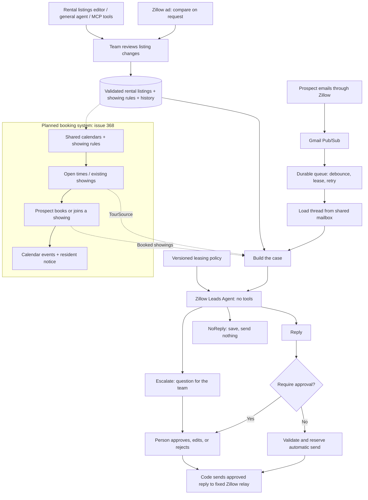

# Zillow Leads Agent

The dedicated agent for inbound Zillow rental inquiries. It reads one prepared
case and returns **Reply**, **NoReply**, or **Escalate**. It has no tools. Code
loads the data, fixes the recipient, saves the outcome, and handles delivery.
Approval is on by default; the dedicated Agent settings tab can enable automatic
replies. The general agent’s permissions are unaffected.

This is the active implementation. The retired `api/src/zillow_email/` module
was an older scheduled thread assessor with contact/calendar side effects. It
was disabled before this package replaced the general agent's Zillow email
runs, and has been removed; Git history holds it if needed. The remaining
`zillow_email_jobs` table, legacy `zillow_email_config` batching setting, and
`triggers/zillow_email_event_trigger.py` belong to the **active queue**, not the
retired module. Their names and stored identifiers are intentionally stable.

- [Public architecture](https://eesposito.com/systems/leasing-leads)
- [Rental listings editor](https://eesposito.com/systems/leasing-leads/listings) (verified Sernia account)
- [Lead trigger settings](https://eesposito.com/systems/leasing-leads/settings) (verified Sernia account)
- [General agent and shared services](../README.md)
- [Evaluation method, commands, and experiment log](evals/README.md)

## Business flow and ownership



The booking integration is **planned**, not active. `NoTours` currently returns
no open times and no booked showings. A case may contain a configured booking
link; without one, the policy tells the lead that the team will check and get
back, and records a team note. A tour recorded in an outcome does not create a
booking, phone contact, or calendar event.

| Component | Owner | Responsibility |
| --- | --- | --- |
| Gmail ingestion | [`google/pubsub`](../../google/pubsub/README.md) | Authenticate notifications, persist mail, enqueue Zillow messages |
| Durable queue | [`triggers/zillow_email_event_trigger.py`](../triggers/zillow_email_event_trigger.py) | Debounce, one leased run per thread, retries, expiry, deduplication |
| Thread loader | `thread.py` | Map the watched mailbox's RFC Message-ID to the shared mailbox and load ordered messages |
| Listing store | [`rental_listings`](../../rental_listings/README.md) | Validated data, history, editor API, on-request Zillow-ad comparison |
| Case preparation | `listing_data.py`, `case.py`, `tours.py` | Convert saved rows and known tour state into the model's input |
| Decision | `agent.py`, `prompts/` | `respond(case)` returns one of the three typed outcomes |
| Review and delivery | `handle.py`, `auto_reply.py` | Persist the outcome; use manual approval or an idempotent automatic send |
| Lead settings | `settings.py` | Authenticated settings API, explicit approval opt-in/out, validated batching window |
| Offline evaluation | `evals/` | Replay scenarios, exact checks, human labels, LLM judge; never imported by runtime code |

The general agent lives in [`../general_agent.py`](../general_agent.py). It
can maintain listings and read the leasing policy as a skill, but the Zillow
queue does not call it. The two agents share conversation storage and the
approval UI, not their execution pipeline or tool access.

## Runtime boundaries

- **No tools or workspace access.** The specialist sees the thread, reviewed
  listing data, booking links, tour times, and low-stakes internal notes. The
  policy tells it not to repeat internal notes; do not put secrets or sensitive
  resident information there.
- **Separate model configuration.** `LEAD_AGENT_MODEL` in `agent.py` controls
  this agent. The general agent's model setting in `/sernia-settings` does not.
- **Fixed routing.** `handle.py` derives the reply route from the latest lead
  message before inference. Only a Zillow relay is allowed. Approving or
  editing the text cannot redirect the recipient.
- **Approval is configurable for this agent only.** With approval on, replies
  wait in `/sernia-chat`. With it off, new replies may be sent automatically;
  pending drafts are not swept up. Escalations and team follow-ups remain tasks
  for a person. NoReply sends nothing.
- **Automatic sends are reserved before Gmail is called.** `auto_approved_sends`
  allows one automatic attempt per original RFC Message-ID. The send card is
  replaced with an inspect-only task before the external call. A timeout or
  process crash cannot leave an actionable duplicate-send approval. Successful
  delivery resolves that task; uncertainty stays with the team.
- **Automatic eligibility is checked in code.** Supplied links and tour times,
  a still-current thread, a valid Zillow route, resolved Gmail threading, and
  the shared automation gate must all pass. Otherwise the draft stays for review.
- **Separate histories.** A lead conversation cannot be continued as a general
  agent chat. The chat endpoint refuses it.
- **Recorded decisions.** Approvals record sent-unchanged, edited, or rejected
  and the outgoing text. Automatically converting those records into eval
  scenarios/labels is still planned.
- **Safe data failures.** If listings cannot be loaded or fail validation, code
  escalates with the reason without asking the model. A failed tour source
  contributes no times; unknown availability is never treated as free.

Queue lifecycle, gates, and recovery queries are in the
[trigger guide](../triggers/README.md#zillow-email-event-trigger).
`zillow_lead_config` owns `debounce_seconds` (60–3,600) and
`require_approval`. The authenticated GET/PATCH endpoint is
`/api/sernia-ai/zillow-leads/settings`; PATCH includes `settings` and `based_on`
to reject stale saves. Missing or invalid runtime settings require approval.
Before the new key exists, the legacy batching window is preserved, but its
old ignored approval value is never inherited. The general settings API rejects
legacy Zillow writes and points callers to the dedicated endpoint.

The UI tabs are Architecture, Rental listing data, Agent settings, and Booking
settings. Management tabs require a verified Sernia account. The old listings
URL redirects; `/sernia-settings#zillow-leads` redirects to the new Agent settings
page rather than depending on scrolling an asynchronously rendered form.

## Rental listing data

The owning [rental-listings guide](../../rental_listings/README.md) defines the
schema, API, approval rules, and history. All three maintenance paths are built:

1. A person edits `/systems/leasing-leads/listings`, including showing rules and history.
2. The general agent uses `tools/rental_listing_tools.py`.
3. The standalone Sernia MCP service calls the same authenticated API.

Every save passes the same validation and writes a history row. Agent/MCP
changes to free text or links require approval; typed operational fields follow
the existing tool policy. A person's own form edits are direct saves.

The optional Zillow-ad tool fetches the saved public Zillow URL on request and
returns the ad beside the reviewed listing for comparison. It saves nothing
itself. The lead agent never fetches Zillow; it loads the reviewed database
rows on each run. The Zillow public/editor URLs are team tools and are not
included in the lead's case.

`listing_data.py` converts `rental_listings` and `rental_showing_rules` into
`ListingData`. `rental_listing_changes` retains the history. An empty store
means no listings are available to the agent; documentation does not assert
what is currently saved in production.

## Showing booking integration (planned)

[Issue #368](https://github.com/EmilioEsposito/portfolio/issues/368) owns the
booking system, including a Sernia Capital home page. It is being built
separately. The intended connection is the `TourSource` protocol in `tours.py`:

- Read the showing window, blackout dates, and preferences from rental listings.
- Derive open times from shared-calendar free/busy, with at least 24 hours'
  notice. An unreadable calendar means unknown availability.
- Supply open times and booked showings to the case. Code applies notice,
  showing-window, and blackout checks before offering slots.
- Let a prospect book or join an existing showing through a real booking link.
- Create the calendar events and send resident notice through the existing
  recipient/approval gates. Units without residents need no resident message.

The lead policy already prefers an existing same-unit showing and supports
preferred times; production has no live source for either until that integration
exists. Host assignment, slot capacity, rescheduling, cancellation, spam
protection, and reminders remain booking-design questions. Keep booking state
in its owning module; listing data describes the offer and rules.

## Prompts and evaluations

`prompts/role.md`, `prompts/policy.md`, and `prompts/record.md` are runtime code
in effect: editing them changes the agent. `skill.py` exposes the same
`policy.md` to the general agent as the built-in `zillow-auto-reply` skill;
a workspace skill cannot replace it. The general agent's listing-maintenance
capability is separate from that policy.

The evals call the same `respond(case)` function as production. A **scenario**
is a past thread cut where a response was owed; **listing data** describes
what was known for that experiment; a **case** combines them. Exact checks,
human **labels**, and a separate LLM **judge** measure the outcome. Train/dev/test
splits are by thread, and the test split stays sealed during development.

Follow [evals/README.md](evals/README.md) for exports, experiments, review pages,
labels, judge calibration, and private data handling. Runtime code imports
nothing from `evals/`. Real applicant emails, scenarios, labels, and generated
pages live in ignored `evals/data/`, never Git or the public web app.

Automatic mode is explicit and remains disabled outside production by the
shared automation gate. Evaluate policy changes and prompt-injection cases
through the existing eval workflow; runtime eligibility checks do not replace
those evaluations.

## Verification

Use the isolated worktree test wrapper from the repository root:

```bash
./scripts/worktree-test.sh api/src/tests/test_zillow_*.py \
  api/src/tests/test_pubsub_zillow_enqueue.py \
  api/src/tests/test_email_approval_scope.py \
  api/src/tests/test_rental_listing*.py
```

These mock model/provider calls. Live evaluation commands and private fixtures
are separate, opt-in work documented in the eval guide.
