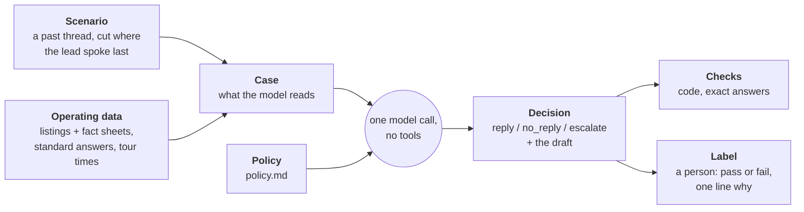
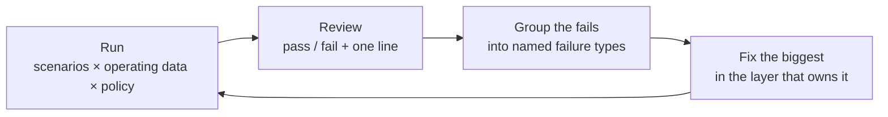
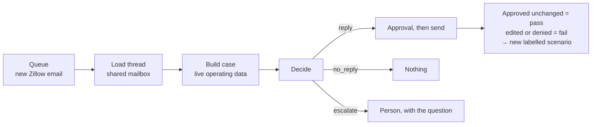

# Zillow lead replies

When a Zillow lead emails, one decision is owed: **reply** (with what), **stay
quiet**, or **hand it to a person**. This package makes that decision a single
step that can be replayed on past emails and scored, so it is improved by
measurement instead of by reading production conversations.

## The whole thing in one picture



| Word | Meaning | Changes when |
|---|---|---|
| **Scenario** | A real conversation up to a moment where we owed a response. Only the emails. | Never. It is history. |
| **Operating data** | What was true of the business then: units, facts about each, standard answers, when tours can happen. | Weekly in season. Its format can change too. |
| **Case** | Scenario + operating data, rendered as text. The model's whole input. | Rebuilt on every run. |
| **Policy** | The instructions: when to reply, what is allowed, how to write. | By commit, after an eval run says the change helps. |
| **Decision** | The model's structured output. | Every run. |
| **Check** | A rule with an exact answer, written as code. | Rarely. |
| **Label** | A person's verdict on one decision, tied to the scenario. | Added each review round. |

Scenarios and labels are the durable assets. Everything between them is free to
change, which is the point: move listings from a notes file to a database, or
tour times from a weekly pattern to a booking service, and the same scenarios
and labels still measure whether replies got better or worse.

## One example, start to finish

**Scenario** (stored once, never edited)

> Monday 9:00 AM, lead: "Hi, I'd like to see 12 Example St #A this week. Does
> it have a dishwasher?"

**Operating data** (one file for the season)

```json
{
  "listings": [{
    "unit": "12-A", "address": "12 Example St #A", "rent": 1500,
    "lease_start_earliest": "2026-07-01",
    "facts": "1 bedroom, second floor\nDishwasher\nTenant pays gas and electric"
  }],
  "standard_answers": "How to apply: on our website, after a tour\nApplication fee: $32",
  "availability": [{"agent": "Alex", "weekday_times": ["10:00", "17:30"]}]
}
```

**Case** (built by code; this text is all the model sees)

```
Current time: Monday, May 4, 2026 at 9:05 AM (America/New_York)

## Listings
- 12-A: 12 Example St #A; $1,500/month; lease starts July 1, 2026; in-person tours only
  - 1 bedroom, second floor
  - Dishwasher
  - Tenant pays gas and electric

## Standard answers
- How to apply: on our website, after a tour
- Application fee: $32

## Tour times that may be offered
- Tuesday, May 5: 10:00 AM, 5:30 PM
- Wednesday, May 6: 10:00 AM, 5:30 PM

## Thread (oldest first)
### Message 1: Lead, Monday, May 4 at 9:00 AM
Hi, I'd like to see 12 Example St #A this week. Does it have a dishwasher?
```

Code already removed Monday's times (24-hour notice) and the agent's name.

**Decision** (from the model)

```json
{
  "action": "reply",
  "reason": "New lead asking for a tour and one question the fact sheet answers.",
  "reply_body": "Hello, yes, the apartment has a dishwasher. We can show it at: ...",
  "offered_slots": ["2026-05-05T10:00-04:00", "2026-05-05T17:30-04:00", "..."],
  "lead": {"unit": "12-A"},
  "tour": {"status": "proposed"}
}
```

**Checks** (code): offered times are all on the list ✓ · signature present ✓ ·
no staff names ✓ · no em-dash ✓

**Label** (you): `fail`, "answered the question but buried it under four tour
times; lead with the answer."

Thirty labels like that, grouped, say what to fix next and in which layer.

## The loop



| A failure like | Is fixed in | Not in |
|---|---|---|
| "Didn't know the unit has parking" | Operating data: the unit's fact sheet | the prompt |
| "Offered a time inside the notice period" | Code: slot arithmetic | the prompt |
| "Tone too stiff", "replied when it should have waited" | Policy: `policy.md` | code |
| "Asked for a discount" | Nowhere. Escalating is correct | |

Two rounds so far, same 30 real scenarios:

| Round | Operating data | Reply | No reply | Escalate |
|---|---|---|---|---|
| 1 | rent and lease dates only | 12 | 6 | 12 |
| 2 | + fact sheets and standard answers | 20 | 5 | 5 |

The policy barely changed between them. Most escalations were missing facts,
not bad judgement, and only running the cases showed that.

## What a listing needs

From this season's 353 decision points: about 9 in 10 first messages ask for a
tour, most follow-ups are tour logistics or a plain "thanks", and roughly 1 in
10 messages asks something about the unit or about applying.

**Typed fields**: only what code or a check reads.

| Field | Used for |
|---|---|
| `unit`, `address` | Matching the inquiry to a listing |
| `rent` | Stated in replies; a future exact check |
| `lease_start_earliest`, `lease_start_latest` | Move-in fit |
| `virtual_tours` | Which virtual-tour answer applies |
| `rented_on` | Dropping the unit from offers from that date |

**`facts`**: free text, one fact per line. In order of how often leads ask:
bedrooms and layout, floor, pets, utilities (included / tenant pays), lease
length, laundry, dishwasher and air conditioning, parking, deposit, outdoor
space, furnished or not. Add a line whenever an escalation shows one missing.

**`standard_answers`**: free text, the same for every unit. How to apply and
when, the fee, who must apply, how long review takes, what holds the unit after
approval, deposit amount.

Exceptions stay out of both on purpose: a discount, an odd lease length, an
applicant without a credit file. Those escalate.

Tour times are the same idea. Today a weekly pattern per person is turned into
slots by `offerable_slots()`. A calendar or booking service can supply the
slots instead (`build_case(..., slots=...)`); the case stores the times, never
their source. Checked once, not built: the existing service account can read
free/busy for a domain user's calendar and for an outside calendar shared with
that user. A calendar that is not shared comes back as an error, which must be
read as "unknown", never as "free".

## Running it

```bash
# Once per season: cut past threads into scenarios (applicant emails: keep outside the repo)
uv run python -m api.src.sernia_ai.zillow_leads.evals export \
    --after 2026-04-01 --before 2026-08-01 --out <private>/scenarios.jsonl

# Each round: run a sample and send the experiment to Logfire
uv run python -m api.src.sernia_ai.zillow_leads.evals run \
    --scenarios <private>/scenarios.jsonl --operating <private>/operating.json \
    --name round-3 --sample 30 --seed 7 --out <private>/runs/round-3.jsonl

# Then: write the page you label that run on, and open it in a browser
uv run python -m api.src.sernia_ai.zillow_leads.evals review \
    --scenarios <private>/scenarios.jsonl --operating <private>/operating.json \
    --run <private>/runs/round-3.jsonl --out <private>/runs/round-3.html
```

The review page shows, per decision: what the lead wrote, what the model
decided and drafted, and (folded away) everything the model was given and what
we really sent at the time. Mark pass or fail and write one line on why. Labels
are kept in the browser as you go; **Download labels** saves them as
`<run>-labels.json`, one row per scenario:

```json
{"scenario_id": "…", "verdict": "fail", "note": "buried the answer under the tour times", "action": "reply"}
```

A run records the policy commit, the model, and a hash of the operating file,
prints counts only, and appears in Logfire under AI Evaluations. The same
`--seed` picks the same scenarios, so rounds compare like for like.

Real scenarios, review pages, labels and the season's operating file hold
applicant emails and business details. They stay out of Git and out of CI. A small synthetic set
will live in the repo for CI.

## In production



Same `decide()` as the evals; only the source of the case differs. Code picks
the recipient, subject and thread, never the model. Every approval becomes a
label, so the set keeps growing without a review session.

**One mailbox.** The Gmail watch is on one person's mailbox and replies go out
from the shared one. Gmail IDs differ per mailbox, so `thread.py` finds the
shared mailbox's copy by its RFC `Message-ID` header and everything after that
uses shared-mailbox IDs.

## Status

| Piece | File | State |
|---|---|---|
| Durable queue of incoming email | [triggers](../triggers/README.md) | Built |
| Thread loader | `thread.py` | Built |
| Case builder, slot arithmetic | `case.py` | Built |
| Policy and decision step | `policy.md`, `decision.py` | Built, under review |
| Scenario export, runner, exact checks | `evals.py` | Built |
| Review page and label format | `evals.py`, `review.html` | Built |
| Error analysis from labels | | Next, after the first labelled round |
| Model graders, synthetic set, CI | | Planned |
| Apply step; queue switched to this task | | Planned |

Until the last row lands, the queue still starts a general Sernia agent run
that follows the `zillow-auto-reply` workspace skill.
