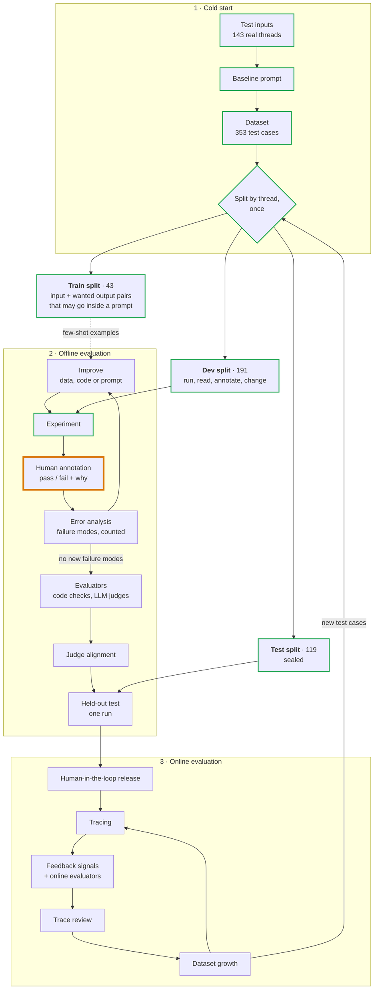

# How the reply decision is evaluated

The method this package follows, the name the field gives each part, and where
we are in it. [The package README](../README.md) describes the system; this describes the
method. An interactive version, with an example for every stage, is at
[eesposito.com/systems/leasing-evals](https://eesposito.com/systems/leasing-evals).

## Process overview



A green outline marks a finished stage; orange marks the current one.

The whiteboard version:

| Phase | What happens |
|---|---|
| Cold start | inputs → baseline prompt → dataset → split into train, dev, test |
| Offline | on dev: experiment → annotate → error analysis → improve, repeated. Then evaluators → judge alignment → one run on test |
| Online | release behind approval, then tracing → feedback and online evaluators → trace review → dataset growth, repeated. New test cases flow back to offline |

## Terms

The field has not settled on one vocabulary. The first column is the name used
most often; the second lists others for the same thing.

| Term | Also called | Here |
|---|---|---|
| Test case | task, example | A scenario: one thread, cut at a moment a response was owed |
| Dataset | eval set; golden dataset once it has reference outputs | 353 scenarios from 143 threads |
| Reference output | golden answer, expected output, ground truth | The reply a person would send. Optional; added during annotation |
| Train split | few-shot examples, training set | 43 scenarios |
| Dev split | validation set, development set | 191 scenarios |
| Test split | held-out set, holdout | 119 scenarios |
| Experiment | eval run | One policy version run over a sample |
| Trace | transcript, trajectory | The full record of one model run |
| Human annotation | labeling, human review | Pass or fail plus one line, on the review page |
| Error analysis | failure analysis; open coding then axial coding | Grouping fail notes into failure modes |
| Failure mode | failure type; the full list is a failure taxonomy | Not known yet |
| Evaluator | grader, scorer, metric | `ReplyChecks` and, later, judges |
| Code evaluator | assertion, code-based grader | Four today |
| LLM judge | LLM-as-judge, model-based grader | None yet |
| Judge alignment | calibration, validating the judge | Not started |
| Offline evaluation | pre-deployment evaluation | Everything so far |
| Online evaluation | post-deployment evaluation, production monitoring | Planned |
| Guardrail | inline check | An evaluator that blocks a send, not just scores it |
| Human-in-the-loop | HITL, approval gate | The existing approval step |
| Regression suite | regression tests, CI evals | Planned, on synthetic cases |

## 1. Cold start

This phase starts with no outputs and no labels. The sources describe it
without agreeing on a name.

- **Test inputs.** Use real history when it exists; it carries the real mix of
  easy and odd cases. With none, generate synthetic inputs: name the dimensions
  that vary, write combinations by hand, have a model turn each into a message.
  Synthetic data finds failures but cannot say how common they are. We had 143
  real threads.
- **Baseline prompt.** A first version written to have outputs to read. Ours is
  `prompts/policy.md`, rewritten from the old workspace skill.
- **Dataset.** Each thread is cut at every point where the lead spoke last and
  a response was owed. Past replies are kept for the reviewer to see and are
  not treated as correct.
- **Split.** Done before reading any results; see the next section.

## The three splits

| Split | What is in it | Who looks, and when |
|---|---|---|
| **Train** | Worked examples that may be pasted into a prompt. Each is an input paired with the output we want: for the policy, a case and the reply a person would send; for an LLM judge, a reply with its verdict and reason. Nothing is trained; the name is inherited from machine learning | Anyone, any time. An example inside a prompt can no longer test that prompt |
| **Dev** | The cases all iteration happens on | Anyone, as often as needed. Its score drifts upward as changes fit it |
| **Test** | Cases no change has been fitted to | Nobody until a version is believed finished, then one run |

- **Split by thread.** A later scenario in a thread contains the earlier ones.
- **Assign before looking.** Threads that had already been run were forced into
  dev.
- **Test is used once.** After a test result informs a change, those threads
  count as dev, and new production cases refill the unseen pool.
- **Two things get split.** Scenarios are split to tune the policy. Later, the
  annotations made on dev are split again, the same three ways, to tune a
  judge. The published guidance (10 to 20% train, the rest evenly dev and test,
  per Husain and Shankar; 75% dev and 25% test, per Yan) is about the second.
  Using the same split for the first is this project's extension of that
  reasoning.
- **The test threads are not entirely unseen.** Before the split existed,
  every thread was read in aggregate twice: to count what leads ask about, and
  to copy unit facts out of our own past replies. No decision has been run on
  a test thread.

## 2. Offline evaluation

**Experiment.** One fixed version run over dev cases, stored with the policy
commit, the model and a hash of the operating data.

**Human annotation.** One person who knows the business marks each decision:

- Pass or fail. The verdict is binary because the difference between a 3 and
  a 4 on a five-point scale is subjective and inconsistent.
- One line on why, written so a new hire would understand it.
- Optionally, the reply they would have sent. It is one acceptable answer
  among several, so it serves as an example and is not an exact target.

No rubric and no reference outputs are needed first. The criteria come out of
reading real outputs.

**Error analysis.** Name each failure (open coding), merge the names into a few
failure modes (axial coding), count them. Fix the largest in the layer that
owns it: operating data for a missing fact, code for an exact rule, the policy
for judgement. Start with about 30 annotations, go toward 100, stop when new
ones reveal no new failure modes.

**Improve.** What gets changed is most often the prompt: the system prompt or
skill, and any few-shot examples in it. But anything that shapes the output can
be the fix: the context the prompt is built from, tool definitions and their
descriptions, the output schema, the model and its settings, or the code around
the call. Error analysis indicates which one. Here the first improvement was
to context (unit fact sheets), not to the prompt.

**Evaluators.** Each stable failure mode gets an automatic check: code where
the rule has an exact answer, an LLM judge where it takes judgement, one judge
per failure mode answering one yes-or-no question.

**Judge alignment.** A judge is trusted only after its verdicts are compared
with human annotations it has not seen, reporting how many real fails it
catches (true positive rate) and how many good outputs it passes (true negative
rate).

**Held-out test.** The frozen version runs once on the test split. If the
result is used to tune the system, the test split has become part of dev.

## 3. Online evaluation

- **Human-in-the-loop release.** Every reply waits for approval at first.
- **Tracing.** Every run is recorded in full, which the application already
  does.
- **Feedback signals.** An approval is an annotation: sent unchanged is a pass,
  edited is a fail with a reference output attached, rejected is a fail.
- **Online evaluators.** The same checks, on live traces. A check that must
  stop a send is a guardrail.
- **Trace review.** Error analysis applied to a weekly sample of production
  traces, always including some at random.
- **Dataset growth.** Each failure becomes a test case; fixed ones stay in a
  regression suite that runs on every change.

## Log

| Experiment | Change before it | Sample | Reply / quiet / escalate | Annotated |
|---|---|---|---|---|
| 1 | Baseline prompt. Listings had rent and lease dates only | 30 | 12 / 6 / 12 | No |
| 2 | Fact sheets and standard answers added to operating data | same 30 | 20 / 5 / 5 | No |
| 3 | Policy checked against the original skill: decline a low self-reported credit score, apply only after a tour, restored tour and virtual-tour rules | same 30 | 19 / 5 / 6 | No |
| 4 | Tours offered through a booking link by default; times only when a tour is already booked or the lead named a time | same 30 | 20 / 4 / 6 | No |
| 5 | Standard answers moved from the case into the policy | same 30 | 19 / 4 / 7 | 26 of 30: 23 pass, 3 fail |
| 6 | First fixes from error analysis: escalate when our earlier message is not in the case; leave confirmed tours alone; Zillow form text cleaned | same 30 | 11 / 2 / 17 | Scored against the labels: 19 of 26 |
| 7 | Escalation rule narrowed to what the reply depends on | same 30 | 19 / 4 / 7 | 23 of 26 |
| 8 | Escalation and confirmed-tour rules spelled out case by case | same 30 | 17 / 4 / 9 | 24 of 26 |
| 9 | Same policy as 8 on a newer, cheaper model | same 30 | 15 / 4 / 11 | 23 of 26 |
| 10 | Booking line reworded by the owner to say "in-person showing" | same 30 | 18 / 3 / 9 | 24 of 26. 15 annotated afresh: all pass |
| 11 | Nothing. Same policy and model as 10 | 30 new dev cases | 13 / 5 / 12 | Not yet |

Experiment 1 was never annotated. The change before experiment 2 was chosen
from the model's own escalation questions, which asked for facts the case
lacked. That is a fair reason to fix the data, but it is not a human judgement
of quality. The change before experiment 3 came from the owner reading the
policy against the original skill, and the change before experiment 4 was a
decision by the owner about how tours are offered. Experiment 5 only moved text
that is the same for every lead from the case into the policy. It is the first
to be annotated, and so the baseline. It is also the first in which a code
evaluator failed: one reply offered a time inside the 24-hour notice period.

Each of these changes was made before any output had been annotated. Once
annotation starts, a change should follow from error analysis, and the
annotated experiment stays fixed until its review is finished.

Experiment 10 changed one phrase. All 9 replies that gave the booking link used
the new wording. Four cases changed action against experiment 9 and only 2 of
30 outputs were word-for-word the same, which is the run-to-run variation seen
before, so those four changes are not credited to the edit.

Experiment 11 is the first on a second sample: 30 dev scenarios that no earlier
run had covered, drawn with `--exclude-run`. The first sample had stopped
producing fails, so it could no longer show where the policy is weak. In the
model's own reasons, most of the 12 escalations on the new sample share one
cause: our earlier message in the thread offered a tour time that the case does
not list. The season's operating file holds one set of tour times, not the
times that were on offer on each past date, so this may be a gap in the replay
data and not in the agent. That reading is not a human judgement yet.

The split was made after experiment 2. Both samples are all in dev.

## First error analysis

Experiment 5, 26 annotated decisions. The four left out were the ones the
reviewer found hardest to judge, three of them escalations, so the 88% pass
rate is likely a little high.

| Failure mode | Fails | Owner |
|---|---|---|
| Replied when our own earlier message in the thread conflicts with the case (a unit or a tour time the case does not list). The case can lag behind what the team has said, so this should escalate | 2 | Policy |
| Offered to move a tour that was already confirmed, when the lead had only confirmed it | 1 | Policy. The code check on allowed times also caught it |

Two notes on decisions that passed:

| Observation | Seen in | Owner |
|---|---|---|
| Zillow's own form text is left in lead messages (a scam warning, field labels, a "Send application" button), and one reply treated the button as a request | Form text in 19 of 30 lead messages; the button in 4 | Code: the thread cleaner |
| The answer about applying gives the steps to someone who has not toured. The reviewer's rewrite withholds them and states the rule | 1 corrected reply | Policy |

Three fails are too few to rank with confidence. The next sample should be new
dev cases, not these 30, until new annotations stop revealing new failure modes.

## Checking a fix against the labels

Experiments 6 to 9 were not annotated again. Each was scored by code against
the 26 labels: a decision the reviewer passed should keep the same action, and
a decision they failed should take the action their note asked for. This is a
regression check, not a judgement of quality. It cannot tell whether a reworded
reply is still a good one, and no LLM judge exists yet to do that.

It did its job on the first attempt. The first escalation rule fixed two of the
three fails and broke six decisions that had passed, by escalating whenever an
earlier message mentioned anything the case lacked. Without the 23 passing
labels that would have looked like an improvement.

A difference of one decision between two experiments is within the variation
from one run to the next. The model words, and sometimes decides, the same case
differently each time, so experiments 7, 8 and 9 are not distinguishable on 26
labels. Telling them apart needs more labelled cases, several runs per case, or
both.

## Where the data lives

Everything real is in `evals/data/`, which Git ignores. Nothing in it is ever
committed, pushed or used in CI, because scenarios are applicants' emails.

```
evals/data/
├── review.html, dataset.html   the two pages, at the top so their links stay put
├── scenarios/                  the season's scenarios and the split
├── operating/                  the season's listings, tour times, booking links
├── runs/                       each experiment's outputs and the instructions it ran on
└── annotations/
    ├── annotations.jsonl       every verdict ever given, one row each
    └── downloads/              the files the review page saved, as they were
```

| File | What it is | Can it be rebuilt? |
|---|---|---|
| `scenarios/scenarios-<season>.jsonl` | Past threads cut at each point a reply was owed | Yes, by `export`, from Gmail |
| `scenarios/splits-<season>.json` | Which thread is train, dev or test | No. A split is made once |
| `operating/operating-<season>.json` | Listings, tour times and booking links as they were that season | No. Written by hand |
| `runs/*.jsonl`, `runs/*.policy.md` | Each experiment's outputs and the instructions it ran on | Only by paying for the run again, and the wording will differ |
| `annotations/annotations.jsonl` | The store of verdicts | No |
| `review.html`, `dataset.html` | The pages, generated from the files above | Yes |

### Annotations

"Label" and "annotation" mean the same row here: a verdict, the reviewer's
note and, optionally, the reply they would have sent.

The store only grows. `collect` appends the verdicts in a downloaded file and
never rewrites a row, so a changed verdict is a later row and the earlier one
stays. Each row holds the scenario, the run, the date and the output that was
judged, so it can be read without the run file.

A verdict is true of one output on one input, for the rules in force on its
date. That makes every row usable twice:

- as data for an LLM judge: an input, an output and a person's verdict;
- as a regression case: the scenario and the note say what a good answer
  needs, and each later output on that scenario is judged again.

Where a case comes from and where copies of it go:

| Place | What is there |
|---|---|
| Gmail, the shared mailbox | The original emails. `export` reads them with read-only access; this is the only source |
| `evals/data/` on one machine | The only stored copy of the scenarios, splits, labels and runs. It is not backed up by anything in this project |
| The browser | Labels in progress, in the review page's local storage, until **Download labels** saves them to a file |
| The model provider | During `run`, each case is sent to the model through OpenRouter, the same as a live lead would be |
| Logfire | `run` records each experiment as traces, which include the case text and the output |

The production database also holds copies of the same emails, kept by the
email pipeline. The evals do not read it.

In a disposable Git worktree, make `evals/data` a symlink to a folder that
outlives the worktree, because removing a worktree deletes its ignored files:

```bash
ln -s "$(cd "$(git rev-parse --path-format=absolute --git-common-dir)/.." && pwd)/.local/zillow-evals" \
    api/src/sernia_ai/zillow_leads/evals/data
```

## Sources

- Hamel Husain and Shreya Shankar, [AI Evals: Everything You Need to Know](https://hamel.dev/blog/posts/evals-faq/):
  error analysis, binary annotations, synthetic data, the train / dev / test
  split for a judge, offline and online evals, guardrails.
- Hamel Husain, [Using LLM-as-a-Judge](https://hamel.dev/blog/posts/llm-judge/):
  one domain expert, a written critique with every verdict, true positive and
  true negative rates.
- Eugene Yan, [Product Evals in Three Simple Steps](https://eugeneyan.com/writing/product-evals/):
  label, align the evaluator on dev and check it on test, one evaluator per
  dimension.
- Anthropic, [Demystifying evals for AI agents](https://www.anthropic.com/engineering/demystifying-evals-for-ai-agents):
  tasks, trials, graders and transcripts; capability evals that graduate into
  a regression suite.
- LangSmith, [Evaluation concepts](https://docs.langchain.com/langsmith/evaluation-concepts):
  dataset, example, experiment, evaluator, reference output; how offline and
  online evaluation feed each other.
- OpenAI, [Evaluation best practices](https://developers.openai.com/api/docs/guides/evaluation-best-practices):
  where eval data comes from, calibrating automatic scoring against people,
  evaluating on every change.
