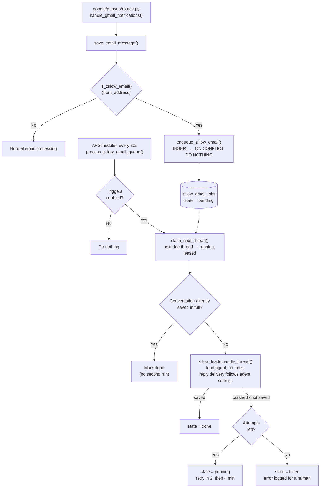

# Zillow lead queue

Zillow lead processing through a **durable queue**. When an email from `zillow.com` arrives via Gmail Pub/Sub, a row is written to the `zillow_email_jobs` table. A scheduled worker (every 30 seconds) picks up due jobs, groups them by lead thread, and hands each thread to the **dedicated lead agent** ([Zillow Leads Agent](README.md)), once per thread.

Zillow email does not start the general Sernia agent. That agent has tools and access to company data, and a lead's email is text written by a stranger; the lead agent has no tools and sees nothing private. Replies either wait for approval or use the dedicated automatic-delivery path, according to the lead agent’s own settings. Code fixes the Zillow relay recipient. See the package README for delivery checks and recovery behavior.

Batching and email approval are configured in the **Agent settings** tab
(`/systems/leasing-leads/settings`), backed by `zillow_lead_config`. Approval
defaults on. The legacy batching window is inherited until the new setting is
saved, but the old ignored `require_approval` value is never inherited.



### Job lifecycle

| State | Meaning |
|-------|---------|
| `pending` | Waiting for its debounce window or retry delay (`next_attempt_at`). |
| `running` | Claimed by a worker under a 30-minute lease (`lease_token`, `lease_until`). `conversation_id` is set from the first claim on. |
| `done` | The run was saved; `conversation_id` links to it. |
| `failed` | Three attempts used. Nothing retries it; an error-level log names the emails. |
| `expired` | The email was more than 24 hours old before it could be processed. |

### Key design choices

- **Recorded before anything else** — the row is committed inside the Pub/Sub handler. A deploy or crash afterwards loses nothing; the worker resumes from the table. (The previous version kept arriving emails in process memory for the debounce window and lost them on restart.)
- **Idempotent enqueue** — `message_id` is unique, so a Pub/Sub redelivery or a Gmail label-change notification for an email already seen inserts nothing. The webhook therefore enqueues on every notification without deciding whether the email is "new". The email is queued *before* it is counted as processed, so if the insert fails the webhook answers non-2xx and Pub/Sub delivers it again — a lead is never acknowledged without being in the queue.
- **Freshness limit** — emails older than 24 hours are not queued, and queued jobs expire at that age. This bounds the backlog after an outage and makes label changes on old emails harmless.
- **One run per lead thread, one at a time** — the first email in a thread starts that thread's debounce window (`zillow_lead_config.debounce_seconds`); further emails in the same thread before it fires ride along. A thread with a run in progress (a live lease) is not claimable at all: an email that arrives mid-run stays `pending` and gets its own run afterwards. Two runs on one lead at once could send conflicting replies.
- **Leases, not locks held open** — a claim marks rows `running` with a lease. If the worker dies, the lease runs out and the rows become claimable again. Results are written only where `lease_token` still matches, so a worker that outlived its lease cannot overwrite the next owner. Claims are serialized by a Postgres advisory lock so two workers cannot split one thread.
- **Batches are fixed at first claim** — the jobs claimed together are a *batch*, and the batch is given its conversation ID (`zillow-{thread_id}-{last job id}`) then, stored on its rows. A later email in the thread never joins a batch that is being retried; it forms the next batch. This is what keeps a retry pointed at the same conversation, and it means each batch counts its own attempts.
- **At-least-once, made safe** — the same emails can be handed to the agent twice (a run that crashed part-way, or a crash between "saved" and "marked done"). Three things keep a lead from getting two replies:
  1. a retry reuses the batch's conversation ID, so it overwrites rather than adds a second conversation;
  2. a batch whose conversation was already saved in full is marked done without running again;
  3. delivery consumes the pending reply under a conversation lock. Automatic delivery also reserves the inbound RFC Message-ID before calling Gmail; an uncertain result becomes an inspect-only team task, never an automatic retry.
- **Retries with backoff, then stop** — a crashed or unsaved run goes back to `pending` (2 minutes, then 4). After three attempts it is parked as `failed` with an error-level log.
- **No email content in the table** — a job holds IDs, subject and sender only. The agent reads the email from Gmail when it runs.
- **Shared-mailbox thread** — a job holds the Gmail IDs of the watched mailbox, but the lead agent works in the shared one, where the same email has different IDs. The worker looks up the shared copy by RFC `Message-ID` ([`thread.py`](thread.py)) and passes that thread on. An email with no shared copy yet, or a Gmail error during the lookup, fails the batch, which is retried.
- **Instructions are in the repository** — the lead agent's prompt is [`prompts/policy.md`](prompts/policy.md) between a short `role.md` and `record.md`, versioned by commit so a change can be evaluated before it merges. The general agent reads the same `policy.md` as its `zillow-auto-reply` skill, which is now built in code ([`sernia_ai/lead_policy.py`](../sernia_ai/lead_policy.py)) and no longer kept in the workspace.
- **One sender check** — `is_zillow_email()` parses the `From` header and matches the address's domain (`zillow.com` or a subdomain). The Pub/Sub route calls it rather than testing for a substring, which would also accept `"noreply@zillow.com" <someone@elsewhere.com>`.
- **Pushes only when a person is needed** — a drafted reply or an escalation fires the approval push (`notify_pending_approval`). A lead that needs no reply is saved without one.
- **Coexists with scheduled check** — `run_scheduled_checks()` still runs as a safety net.

### Inspecting the queue

```sql
-- What is waiting, running, or stuck
SELECT state, count(*), min(created_at), max(created_at)
FROM zillow_email_jobs GROUP BY state;

-- Jobs that need a human
SELECT message_id, thread_id, subject, attempts, last_error
FROM zillow_email_jobs WHERE state = 'failed' ORDER BY created_at DESC;
```

To retry a parked job after fixing the cause, set it back to waiting:
`UPDATE zillow_email_jobs SET state = 'pending', attempts = 0, next_attempt_at = now(), expires_at = now() + interval '24 hours' WHERE message_id = '…';`

## Deployment compatibility

`queue.py` owns the worker; `models.py` owns `ZillowEmailJob`. The persisted
`zillow_email_jobs` table, `zillow-email-queue` job ID, advisory lock key,
conversation IDs, leases, and retry policy remain unchanged.

APScheduler stores Python callable paths. The former
`sernia_ai/triggers/zillow_email_event_trigger.py` retains only a worker import
so existing jobs can deserialize before startup updates them to
`api.src.zillow_leads.queue:process_zillow_email_queue`. Keep that shim until
all deployed job stores have been migrated.
