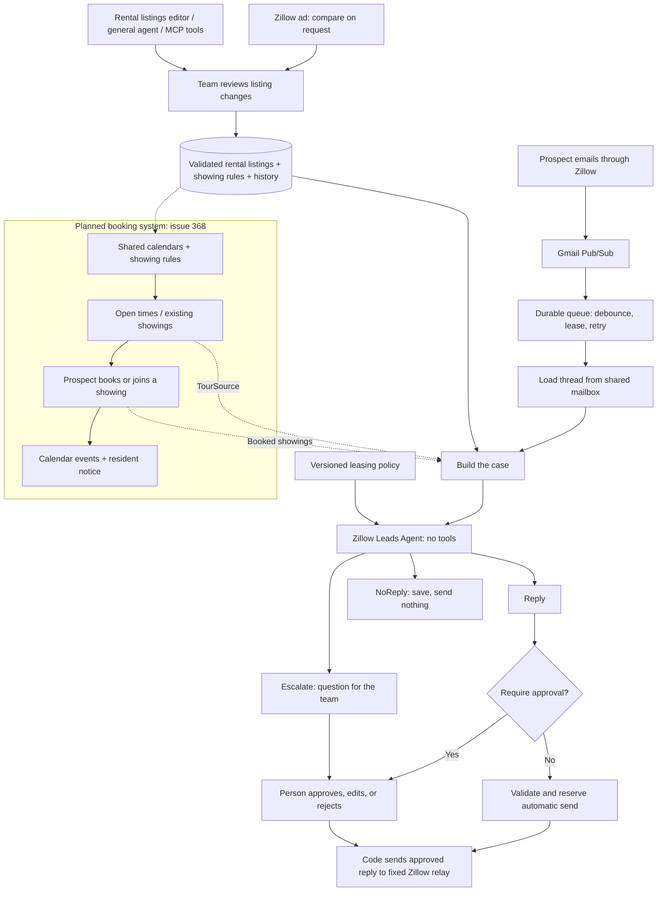

# Zillow Leads Agent

The dedicated agent for inbound Zillow rental inquiries. It reads one prepared
case and returns **Reply**, **NoReply**, or **Escalate**. It has no tools. Code
loads the data, fixes the recipient, saves the outcome, and handles delivery.
Approval is on by default; the dedicated Agent settings tab can enable automatic
replies. The general agent’s permissions are unaffected.

This is the active implementation. The retired `api/src/zillow_email/` module
was an older scheduled thread assessor with contact/calendar side effects. It
was disabled before this package replaced the general agent's Zillow email
runs, and has been removed; Git history holds it if needed. The remaining
`zillow_email_jobs` table, legacy `zillow_email_config` batching setting, and
`queue.py` belong to the **active queue**, not the retired module. Stored
identifiers remain stable across the package move.

- [Public architecture](https://eesposito.com/systems/leasing-leads)
- [Rental listings editor](https://eesposito.com/systems/leasing-leads/listings) (verified Sernia account)
- [Lead trigger settings](https://eesposito.com/systems/leasing-leads/settings) (verified Sernia account)
- [General agent](../sernia_ai/README.md)
- [Evaluation method, commands, and experiment log](evals/README.md)

## Business flow and ownership



The booking integration is **switched off**. `handle.py` asks
`showing_bookings/lead_tours.py` for its tour source on each lead: unless the
Booking settings tab's switch `lead_agent_uses_open_times` is on, and whenever
that setting cannot be read, it is `NoTours`, which returns no open times and
no booked showings. With the switch on, the booking service's open times and
showings with room come through `tours_for_case` like any other source. A case may contain a configured booking
link; without one, the policy tells the lead that the team will check and get
back, and records a team note. With the switch off, a tour recorded in an
outcome does not create a booking, phone contact, or calendar event. With it
on, a sent reply that confirms a tour books it; see "Showings agreed by email"
below.

### What the case knows about showings

With the switch off, the case, its rendered text and the automatic-send checks
are exactly what they were before the booking service existed;
`test_zillow_lead_case_unchanged.py` compares them byte for byte with a
snapshot of the existing fixtures. With it on, three things change, all filled
in by code (`showing_bookings/lead_tours.py`):

- **A link per lead.** Each thread gets one random token (`lead_links.py`,
  table `zillow_lead_links`: thread id, token, created), made the first time
  the thread is handled with the switch on. It holds no personal data and
  appears only in that thread's links. Each unit's booking link in the case is
  the booking page with it: `<SHOWING_PUBLIC_BASE_URL>/showings/<unit>?t=<token>`.
  A booking made through it is tied to the thread
  (`showing_attendees.zillow_thread_id`); see the booking service's README.
- **The lead's own showings.** `LeadCase.own_showings` lists the thread's
  upcoming showings from the attendee rows tied to it: unit, start, and
  booked or who cancelled it. The rendered case shows them under "This lead's
  own showings", or "(none)". With the switch off the field is `None` and the
  section is absent. Nothing about the host or other attendees is included.
- **Tour times know their unit.** `TourSlot.unit` is set by the booking
  service, so each unit lists its own times ("- 320-03, Wednesday, April 14:
  4:00 PM"). Times from a weekly pattern have no unit and read as before. The
  fixed rules (`within_showing_rules`) still apply to every time.

The automatic-send check (`auto_reply.reply_problems`) reads links from the
case, so the per-lead link passes and any other link (the unit's page without
the token, another lead's token) does not. A time must still be one the case
offers; when the case's times belong to units and the reply's `lead.unit` is a
listed unit, it must be open at, or a showing booked at, that unit. The lead's
own booked showing may be repeated back. The evals' `ReplyChecks` use the same
calculation (`case.allowed_tour_times`), so the two cannot disagree. The policy does not mention the own
showings yet; that is a later step of issue #368, run through the evals first.

Each outcome also saves the structured case in the conversation's metadata
(`case`, from `case.case_record`), so a past decision can be rebuilt with
`case.case_from_record` once times come from calendars, and a production lead
can become an eval scenario. It leaves out what the rendered case does not
show: weekly-pattern staff names and the lead's email addresses. This is saved
whatever the switch says.

### Showings agreed by email

With the switch on, code books, moves and cancels the thread's showings from
the agent's decisions (`showing_bookings/lead_bookings.py`). The agent still
has no tools and the case gains nothing private; who a reply goes to, the
approval flow and the one-send reservation are unchanged.

**Only a person sends a reply that changes a booking.** With the switch on,
the automatic send works out what sending would do before it reserves
anything. A reply that would book, move or cancel a showing is held as a
reply that fails a check is: nothing is reserved, booked or sent, and the send
card, which already says "Sending this books …", gains "This reply books a
showing, so a person sends it." (or "moves", or "cancels"); the conversation
records `auto_delivery: needs_review`. A reply that changes nothing (no tour,
a virtual tour, a time already booked for the thread) is sent automatically as
before. The reason: the booked time is the agent's structured start time, and
nothing yet checks that the reply's words name it. A check that the words name
the booked time, run through the evals, would let this be relaxed. With the switch off nothing here runs: `handle_thread`,
`apply_approval` and `maybe_send_reply` behave as before, which
`test_zillow_lead_bookings.py` and the case snapshot test check.

| Decision | What happens to the thread's showing at the decision's unit |
| --- | --- |
| A reply a person sends unchanged, with the tour `confirmed` or `rescheduled`, in person, with a start and a listed unit | Booked through `place_booking` (source `lead_agent`) just before the send. Already booked there at that time: nothing new. Booked there at another time: a move, the old place cancelled after the send. |
| A reply a person sends unchanged, with the tour `cancelled` | Cancelled after the send (reason `prospect`). |
| A reply that is rejected | Nothing booked; a place booked for it by a run that stopped before sending is cancelled. |
| `no_reply` recording the tour as `cancelled` | Cancelled at once (reason `prospect`): nothing waits for a send. |
| `escalate` recording the tour as `cancelled` | Nothing; the card lists the times still booked, for the person to cancel. |
| Anything else (proposed, none, virtual, no start, an unlisted unit, no unit) | Nothing. |

The send card says what sending it does before anyone approves, as a team
note, only with the switch on and only when it changes something:
"Sending this books unit 320-03 for Wed, Apr 14 at 4:00 PM.", "Sending this
moves their showing of 320-03 from Wed, Apr 14 at 4:00 PM to Wed, Apr 14 at
5:00 PM.", "Sending this cancels their showing of 320-03 on Wed, Apr 14 at
4:00 PM." Approving the draft unchanged (surrounding whitespace aside)
applies that change. If the thread's showings changed since the card was
written, so that sending now would do something else, nothing is sent: the
card gets "The thread's showings changed since this card was written;
approve again to send it with this change." and the new statement. Approving
**edited** words applies no booking change at all: the reply is sent as
edited, and the result line, the conversation and `showing_booking`
(`not_applied_edited`) say what was not done ("The reply was edited, so the
showing was not booked automatically. Add it on the Booking settings tab if
it still applies.", and the same for a move or a cancellation). A place this
conversation booked for the draft and never sent is cancelled then, as a
rejection cancels it.

Around a send, in order:

- **On approval** (`apply_approval`, under the conversation's row lock): book,
  then send, then settle, then save the decision. A refused time (gone, full,
  off the market, the thread already in that showing, or the booking service
  unreachable) sends nothing: the card stays pending with the reason in its
  team notes, and the answer is `pending_approval`. A person can approve it
  again once the time is free, or reject it.
- **Automatically** (`maybe_send_reply`): books nothing. A reply that would
  change a booking is held for a person before anything is reserved (above).
- **Settling**: sent, the booking's held notices go now and a move's old place
  or a cancellation's places are cancelled. Gmail refused it (a 4xx other than
  a timeout, `handle.send_result`), the booking is cancelled at once
  (`reply_not_sent`), before its held notices could go. Uncertain (a timeout,
  a 5xx, anything else), the booking stands, marked `reply_uncertain` on the
  Showings section.

A process that stops between the booking and the send (which can happen
only inside an approval) leaves the send card pending, and the place
carries the conversation id (`showing_attendees.lead_conversation_id`): a
person who approves recovers it as this reply's booking (kept when the reply
is sent, cancelled if Gmail refuses it); one who rejects, or sends edited
words, cancels it. A place the lead booked through their link, or one an
earlier sent reply booked, is never cancelled by a later reply's failure; nor
is a place whose own reply was sent (`lead_reply_sent_at`, saved with the
release of its notices), even if the process stopped before the approval was
saved and the card is then rejected or approved again and refused. If
nobody ever decides the card, the place stays booked and its held notices go
after five minutes; the card and the Showings section show it. The
conversation keeps what was done under `showing_booking`
(action, unit, start, showing and attendee ids, what was cancelled, the send
result).

The place starts provisional: the thread's name (or "Zillow lead"), the
thread id, no email and no consent to texts; a phone number from the thread is
kept as the mobile for the host and never texted. The host's event and the
residents' text go as for a team booking without texts; nothing goes to the
lead. The reply's own booking link (the case's per-lead link) opens the
booking page in an "add your details" state, which completes the same place
and sends the confirmation text and the invite as for a page booking. The
policy does not yet mention the link line or the own showings; that is a later
step with an eval run.

**The reminder by email.** A lead whose place was booked from a sent reply
(`lead_reply_sent_at`) and who has no mobile with consent gets no reminder
text, so the evening before (6 PM in the showing rules' time zone, sent only
from 8 AM to 9 PM) the booking service emails a reminder in the same thread:
when and where, the cancel link, and the lead's own link to add their details.
It is a fixed template (`showing_bookings/wording.py`, no model) and a notice in
the booking outbox behind its send guard, so outside production it is captured
unless the thread's address is a configured test recipient. Its recipient is
the `reply_route` stored on the conversation that booked the place
(`lead_conversation_id`), read again just before it goes and checked by this
module's relay rule (`relay.py`, which `reply_route` uses too); the conversation
must be about the place's own thread. It is sent with `handle.send_thread_email`,
the same Gmail call as `send_reply`, from the same mailbox, with the thread's
headers, and never unthreaded. If the conversation or its route is gone, or the
route is no longer a Zillow relay, nothing is sent and the notice fails for the
team's alert. A place whose reply is uncertain (`reply_uncertain`) or was never
sent gets none, and nothing is queued with the switch off. See
[the booking service's reminders](../showing_bookings/README.md#reminders-the-evening-before).

| Component | Owner | Responsibility |
| --- | --- | --- |
| Gmail ingestion | [`google/pubsub`](../google/pubsub/README.md) | Authenticate notifications, persist mail, enqueue Zillow messages |
| Durable queue | [`queue.py`](queue.py) | Debounce, one leased run per thread, retries, expiry, deduplication |
| Thread loader | `thread.py` | Map the watched mailbox's RFC Message-ID to the shared mailbox and load ordered messages |
| Listing store | [`rental_listings`](../rental_listings/README.md) | Validated data, history, editor API, on-request Zillow-ad comparison |
| Case preparation | `listing_data.py`, `case.py`, `tours.py`, `lead_links.py` | Convert saved rows, known tour state and the thread's own booking link into the model's input |
| Decision | `agent.py`, `prompts/` | `respond(case)` returns one of the three typed outcomes |
| Review and delivery | `handle.py`, `auto_reply.py`, `relay.py` | Persist the outcome; use manual approval or an idempotent automatic send; book what an approved reply confirms (switch on); the one relay rule for where email may go |
| Lead settings | `settings.py` | Authenticated settings API, explicit approval opt-in/out, validated batching window |
| Offline evaluation | `evals/` | Replay scenarios, exact checks, human labels, LLM judge; never imported by runtime code |

The general agent lives in [`sernia_ai/general_agent.py`](../sernia_ai/general_agent.py). It
can maintain listings and read the leasing policy as a skill, but the Zillow
queue does not call it. The two agents share conversation storage and the
approval UI, not their execution pipeline or tool access. The shared
[conversation router](../agent_conversations/README.md) selects the Zillow handler
from stored metadata and preserves the existing conversation URLs; approving a
lead never imports or resumes the general agent.

## Package boundaries

`zillow_leads/` is a sibling of `sernia_ai/` and imports no general-agent code.
The queue, case preparation, policy, delivery, settings, and evals live here.
The general agent's policy adapter lives with its consumer in
[`sernia_ai/lead_policy.py`](../sernia_ai/lead_policy.py).

Shared services have independent owners:

- [`rental_listings/`](../rental_listings/README.md): listing data and showing rules.
- [`google/gmail/`](../google/gmail/README.md): email cleanup, reply threading, transport.
- [`agent_conversations/`](../agent_conversations/README.md): conversation storage,
  approval helpers, send reservations, persistence identities, and Web Push.
- `database/app_settings.py`: settings rows; `utils/automation.py`: shared automation gates.
- `utils/openrouter_models.py`: provider adapter, reasoning settings, and cost telemetry.
  Each agent still selects its own model.

## Runtime boundaries

- **No tools or workspace access.** The specialist sees the thread, reviewed
  listing data, booking links, tour times, and low-stakes internal notes. The
  policy tells it not to repeat internal notes; do not put secrets or sensitive
  resident information there.
- **Separate model configuration.** `LEAD_AGENT_MODEL` in `agent.py` controls
  this agent. The general agent's model setting in `/sernia-settings` does not.
- **Fixed routing.** `handle.py` derives the reply route from the latest lead
  message before inference. Only a Zillow relay is allowed (`relay.py`).
  Approving or editing the text cannot redirect the recipient. The booking
  service's reminder by email goes only to that stored route, checked again by
  the same rule.
- **Approval is configurable for this agent only.** With approval on, replies
  wait in `/sernia-chat`. With it off, new replies may be sent automatically;
  pending drafts are not swept up. Escalations and team follow-ups remain tasks
  for a person. NoReply sends nothing.
- **Automatic sends are reserved before Gmail is called.** `auto_approved_sends`
  allows one automatic attempt per original RFC Message-ID. The send card is
  replaced with an inspect-only task before the external call. A timeout or
  process crash cannot leave an actionable duplicate-send approval. Successful
  delivery resolves that task; uncertainty stays with the team.
- **Automatic eligibility is checked in code.** Supplied links and tour times,
  a still-current thread, a valid Zillow route, resolved Gmail threading, and
  the shared automation gate must all pass. Otherwise the draft stays for review.
- **Separate histories.** A lead conversation cannot be continued as a general
  agent chat. The chat endpoint refuses it.
- **Recorded decisions.** Approvals record sent-unchanged, edited, or rejected
  and the outgoing text. Automatically converting those records into eval
  scenarios/labels is still planned.
- **Safe data failures.** If listings cannot be loaded or fail validation, code
  escalates with the reason without asking the model. A failed tour source
  contributes no times; unknown availability is never treated as free.

Queue lifecycle, gates, and recovery queries are in the
[queue guide](QUEUE.md).
`zillow_lead_config` owns `debounce_seconds` (60–3,600) and
`require_approval`. The authenticated GET/PATCH endpoint is
`/api/zillow-leads/settings`; the former `/api/sernia-ai/zillow-leads/settings`
URL remains an authenticated alias. PATCH includes `settings` and `based_on`
to reject stale saves. Missing or invalid runtime settings require approval.
Before the new key exists, the legacy batching window is preserved, but its
old ignored approval value is never inherited. The general settings API rejects
legacy Zillow writes and points callers to the dedicated endpoint.

The UI tabs are Architecture, Rental listing data, Agent settings, and Booking
settings. Management tabs require a verified Sernia account. The old listings
URL redirects; `/sernia-settings#zillow-leads` redirects to the new Agent settings
page rather than depending on scrolling an asynchronously rendered form.

## Rental listing data

The owning [rental-listings guide](../rental_listings/README.md) defines the
schema, API, approval rules, and history. All three maintenance paths are built:

1. A person edits `/systems/leasing-leads/listings`, including showing rules and history.
2. The general agent uses `sernia_ai/tools/rental_listing_tools.py`.
3. The standalone Sernia MCP service calls the same authenticated API.

Every save passes the same validation and writes a history row. Agent/MCP
changes to free text or links require approval; typed operational fields follow
the existing tool policy. A person's own form edits are direct saves.

The optional Zillow-ad tool fetches the saved public Zillow URL on request and
returns the ad beside the reviewed listing for comparison. It saves nothing
itself. The lead agent never fetches Zillow; it loads the reviewed database
rows on each run. The Zillow public/editor URLs are team tools and are not
included in the lead's case.

`listing_data.py` converts `rental_listings` and `rental_showing_rules` into
`ListingData`. `rental_listing_changes` retains the history. An empty store
means no listings are available to the agent; documentation does not assert
what is currently saved in production.

## Showing booking integration (planned)

[Issue #368](https://github.com/EmilioEsposito/portfolio/issues/368) owns the
booking system, including a Sernia Capital home page. It is being built
separately. The intended connection is the `TourSource` protocol in `tours.py`:

- Read the showing window, blackout dates, and preferences from rental listings.
- Derive open times from shared-calendar free/busy, with at least 24 hours'
  notice. An unreadable calendar means unknown availability.
- Supply open times and booked showings to the case. Code applies notice,
  showing-window, and blackout checks before offering slots.
- Let a prospect book or join an existing showing through a real booking link.
- Create the calendar events and send resident notice through the existing
  recipient/approval gates. Units without residents need no resident message.

The lead policy already prefers an existing same-unit showing and supports
preferred times; production has no live source for either until that integration
exists. Host assignment, slot capacity, rescheduling, cancellation, spam
protection, and reminders remain booking-design questions. Keep booking state
in its owning module; listing data describes the offer and rules.

## Prompts and evaluations

`prompts/role.md`, `prompts/policy.md`, and `prompts/record.md` are runtime code
in effect: editing them changes the agent. `sernia_ai/lead_policy.py` exposes the same
`policy.md` to the general agent as the built-in `zillow-auto-reply` skill;
a workspace skill cannot replace it. The general agent's listing-maintenance
capability is separate from that policy.

`policy.md` writes the team phone number as `{{team_phone}}`. `load_policy()`
fills it in from the required `SERNIA_TEAM_PHONE` setting (E.164) for both
agents, the evals and the judge, and raises an error naming the setting when it
is missing. The number itself never goes in this public repository.

The evals call the same `respond(case)` function as production. A **scenario**
is a past thread cut where a response was owed; **listing data** describes
what was known for that experiment; a **case** combines them. Exact checks,
human **labels**, and a separate LLM **judge** measure the outcome. Train/dev/test
splits are by thread, and the test split stays sealed during development.

Follow [evals/README.md](evals/README.md) for exports, experiments, review pages,
labels, judge calibration, and private data handling. Runtime code imports
nothing from `evals/`. Real applicant emails, scenarios, labels, and generated
pages live in ignored `evals/data/`, never Git or the public web app.

Automatic mode is explicit and remains disabled outside production by the
shared automation gate. Evaluate policy changes and prompt-injection cases
through the existing eval workflow; runtime eligibility checks do not replace
those evaluations.

## Verification

Use the isolated worktree test wrapper from the repository root:

```bash
./scripts/worktree-test.sh api/src/tests/test_zillow_*.py \
  api/src/tests/test_pubsub_zillow_enqueue.py \
  api/src/tests/test_email_approval_scope.py \
  api/src/tests/test_rental_listing*.py
```

These mock model/provider calls. Live evaluation commands and private fixtures
are separate, opt-in work documented in the eval guide.
