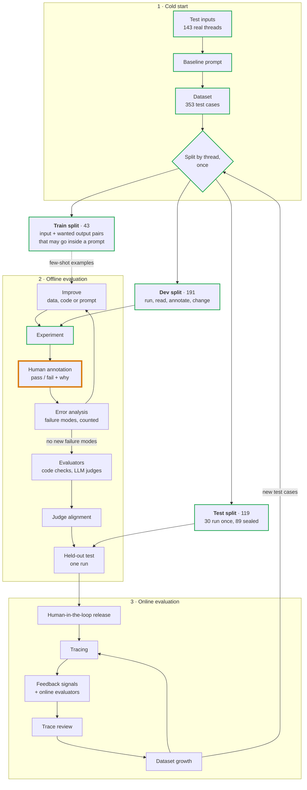

# How the reply decision is evaluated

The method this package follows, the name the field gives each part, and where
we are in it. [The package README](../README.md) describes the system; this describes the
method. An interactive version, with an example for every stage, is at
[eesposito.com/systems/leasing-evals](https://eesposito.com/systems/leasing-evals).

## Running experiments

```bash
# Private data lives in evals/data, which Git ignores. See the private-data section below.
DATA=api/src/zillow_leads/evals/data

# Once per season: cut past threads into scenarios
uv run python -m api.src.zillow_leads.evals export \
    --after 2026-04-01 --before 2026-08-01 --out $DATA/scenarios/scenarios.jsonl

# Once per season: assign each thread to train, dev or test
uv run python -m api.src.zillow_leads.evals split \
    --scenarios $DATA/scenarios/scenarios.jsonl --out $DATA/scenarios/splits.json

# Any time: write a page for reading the train and dev splits (test stays sealed)
uv run python -m api.src.zillow_leads.evals browse \
    --scenarios $DATA/scenarios/scenarios.jsonl --splits $DATA/scenarios/splits.json \
    --run $DATA/runs/round-3.jsonl --review $DATA/review.html \
    --out $DATA/dataset.html

# Each experiment: run a dev sample and send it to Logfire
uv run python -m api.src.zillow_leads.evals run \
    --scenarios $DATA/scenarios/scenarios.jsonl --listings $DATA/operating/operating.json \
    --splits $DATA/scenarios/splits.json --split dev \
    --name round-3 --sample 30 --seed 7 --out $DATA/runs/round-3.jsonl
# Add --exclude-run <earlier run> (repeatable) to sample only scenarios no
# earlier run covered, and --concurrency 10 to run more at once.
# --cases-from <earlier run> runs exactly that run's cases again.
# --case-edits and --carry set a case's tour state by hand and run again only
# the edited cases: see "Setting the tour state by hand" below.

# Then: write the page you label that run on, and open it in a browser.
# Keep --out the same every time, so there is one review page to bookmark.
uv run python -m api.src.zillow_leads.evals review \
    --scenarios $DATA/scenarios/scenarios.jsonl --listings $DATA/operating/operating.json \
    --run $DATA/runs/round-3.jsonl --labels $DATA/annotations/annotations.jsonl \
    --out $DATA/review.html

# After labelling: click Download labels on the page, then add that file to
# the store of every verdict ever given. Adding the same file twice is safe.
uv run python -m api.src.zillow_leads.evals collect \
    --labels ~/Downloads/round-3-labels.json
```

To open the pages over localhost instead of as files:

```bash
uv run python -m api.src.zillow_leads.evals serve
```

It serves `evals/data` to this machine only, at `http://localhost:8377/review.html`
and `/dataset.html`. The review page keeps labels in the browser per address,
so pick one way of opening it and stay with it. In Claude Code, `/eval-links`
lists these pages and the flow diagram with this checkout's ports (the mod is
in `.claude/skills/eval-links`).

`run` saves the policy as it was beside its output (`round-3.policy.md`), and
the review page shows it behind a **Policy** button.

The review page shows, per decision: what the lead wrote, what the model
decided and drafted, and (folded away) everything the model was given and what
we really sent at the time. Mark pass or fail and write one line on why. Labels
are kept in the browser as you go; **Download labels** saves them as
`<run>-labels.json`, one row per scenario:

```json
{"scenario_id": "…", "verdict": "fail", "note": "buried the answer under the tour times",
 "corrected_reply": "", "action": "reply", "output_hash": "…", "run": "round-3"}
```

`corrected_reply` is optional: the reply you would have sent.

A label belongs to the output it judged. The model words the same decision
differently on every run, so after a re-run the page does not reuse a verdict
silently. It shows "On an earlier draft you marked this fail: …" with a **Still
applies** button, and counts the case as unlabelled until you confirm or decide
again. To start a page from labels made elsewhere, pass `--labels <file>`; to
let it recognise labels made on earlier runs, pass `--previous <run.jsonl>`.

The lead agent has its own model setting, `LEAD_AGENT_MODEL` in [`../agent.py`](../agent.py),
separate from the general agent's. `run --model <name>` tries another model on
the same cases without editing code.

A run records the policy commit, the model, and a hash of the listing data file,
prints counts only, and appears in Logfire under AI Evaluations. The same
`--seed` picks the same scenarios, so experiments can be compared on the same
cases.

Real scenarios, review pages, labels and the season's listing data file hold
applicant emails and business details. They stay out of Git and out of CI. A
small synthetic set will live in the repo for CI.

## Process overview



A green outline marks a finished stage; orange marks the current one.

The whiteboard version:

| Phase | What happens |
|---|---|
| Cold start | inputs → baseline prompt → dataset → split into train, dev, test |
| Offline | on dev: experiment → annotate → error analysis → improve, repeated. Then evaluators → judge alignment → one run on test |
| Online | release behind approval, then tracing → feedback and online evaluators → trace review → dataset growth, repeated. New test cases flow back to offline |

## Terms

The field has not settled on one vocabulary. The first column is the name used
most often; the second lists others for the same thing.

| Term | Also called | Here |
|---|---|---|
| Test case | task, example | A scenario: one thread, cut at a moment a response was owed |
| Dataset | eval set; golden dataset once it has reference outputs | 353 scenarios from 143 threads |
| Reference output | golden answer, expected output, ground truth | The reply a person would send. Optional; added during annotation |
| Train split | few-shot examples, training set | 43 scenarios |
| Dev split | validation set, development set | 191 scenarios |
| Test split | held-out set, holdout | 119 scenarios |
| Experiment | eval run | One policy version run over a sample |
| Trace | transcript, trajectory | The full record of one model run |
| Human annotation | labeling, human review | Pass or fail plus one line, on the review page |
| Error analysis | failure analysis; open coding then axial coding | Grouping fail notes into failure modes |
| Failure mode | failure type; the full list is a failure taxonomy | Not known yet |
| Evaluator | grader, scorer, metric | `ReplyChecks` and, later, judges |
| Code evaluator | assertion, code-based grader | `ReplyChecks` |
| LLM judge | LLM-as-judge, model-based grader | `judge.py`; see the judge section and experiment log below |
| Judge alignment | calibration, validating the judge | Initial comparison against human verdicts recorded below |
| Offline evaluation | pre-deployment evaluation | Everything so far |
| Online evaluation | post-deployment evaluation, production monitoring | Planned |
| Guardrail | inline check | An evaluator that blocks a send, not just scores it |
| Human-in-the-loop | HITL, approval gate | The existing approval step |
| Regression suite | regression tests, CI evals | Planned, on synthetic cases |

## 1. Cold start

This phase starts with no outputs and no labels. The sources describe it
without agreeing on a name.

- **Test inputs.** Use real history when it exists; it carries the real mix of
  easy and odd cases. With none, generate synthetic inputs: name the dimensions
  that vary, write combinations by hand, have a model turn each into a message.
  Synthetic data finds failures but cannot say how common they are. We had 143
  real threads.
- **Baseline prompt.** A first version written to have outputs to read. Ours is
  `prompts/policy.md`, rewritten from the old workspace skill.
- **Dataset.** Each thread is cut at every point where the lead spoke last and
  a response was owed. Past replies are kept for the reviewer to see and are
  not treated as correct.
- **Split.** Done before reading any results; see the next section.

## The three splits

| Split | What is in it | Who looks, and when |
|---|---|---|
| **Train** | Worked examples that may be pasted into a prompt. Each is an input paired with the output we want: for the policy, a case and the reply a person would send; for an LLM judge, a reply with its verdict and reason. Nothing is trained; the name is inherited from machine learning | Anyone, any time. An example inside a prompt can no longer test that prompt |
| **Dev** | The cases all iteration happens on | Anyone, as often as needed. Its score drifts upward as changes fit it |
| **Test** | Cases no change has been fitted to | Nobody until a version is believed finished, then one run |

- **Split by thread.** A later scenario in a thread contains the earlier ones.
- **Assign before looking.** Threads that had already been run were forced into
  dev.
- **Test is used once.** After a test result informs a change, those threads
  count as dev, and new production cases refill the unseen pool.
- **Two things get split.** Scenarios are split to tune the policy. Later, the
  annotations made on dev are split again, the same three ways, to tune a
  judge. The published guidance (10 to 20% train, the rest evenly dev and test,
  per Husain and Shankar; 75% dev and 25% test, per Yan) is about the second.
  Using the same split for the first is this project's extension of that
  reasoning.
- **The test threads are not entirely unseen.** Before the split existed,
  every thread was read in aggregate twice: to count what leads ask about, and
  to copy unit facts out of our own past replies.

### First use of the test split

Before the pull request that introduced the lead agent was merged, the final
policy was run once on 30 of the 119 test scenarios (`--split test --sample 30
--seed 17`, saved as `runs/test-chunk-1.jsonl`). No person graded it. The
measures are the code checks and the judge:

| | Dev (experiment 17, 60 decisions) | Test chunk (30 decisions) |
|---|---|---|
| Errors | 0 | 0 |
| Failed code checks | 0 | 0 |
| Judge passes | 48 of 60 (80%) | 25 of 30 (83%) |
| Reply / quiet / escalate | 40 / 6 / 14 | 16 / 2 / 12 |

How to read it:

- The judge's pass rate on cases no rule was fitted to is about the same as on
  dev. So there is no sign that 17 experiments tuned the policy to its 60 dev
  cases. Thirty cases is a small sample: one verdict moves the rate by three
  points.
- The judge is the measure, and it has not been validated beyond agreeing with
  the reviewer's 10 fails. Both columns share that weakness, so the comparison
  holds better than either number alone.
- The test chunk escalates more (12 of 30). Eight of those ask whether a tour
  time from the thread can be honoured, a time the replay does not contain.
  This is the same gap the second sample showed before its tour state was set
  by hand (experiment 11 escalated 12 of 30); no test case has a hand-set tour
  state. The other four are things the policy sends to a person: a voucher
  question, a discount we offered, a credit score range that straddles 600,
  and a virtual showing we offered for a unit listed as in-person only.

The judge's fails on the chunk have been read, so those 30 scenarios now count
as dev. The other 89 are still sealed, for the version that will face real
leads. A later test run passes `--exclude-run runs/test-chunk-1.jsonl` so it
draws only from them.

## 2. Offline evaluation

**Experiment.** One fixed version run over dev cases, stored with the policy
commit, the model and a hash of the listing data.

**Human annotation.** One person who knows the business marks each decision:

- Pass or fail. The verdict is binary because the difference between a 3 and
  a 4 on a five-point scale is subjective and inconsistent.
- One line on why, written so a new hire would understand it.
- Optionally, the reply they would have sent. It is one acceptable answer
  among several, so it serves as an example and is not an exact target.

No rubric and no reference outputs are needed first. The criteria come out of
reading real outputs.

**Error analysis.** Name each failure (open coding), merge the names into a few
failure modes (axial coding), count them. Fix the largest in the layer that
owns it: listing data for a missing fact, code for an exact rule, the policy
for judgement. Start with about 30 annotations, go toward 100, stop when new
ones reveal no new failure modes.

**Improve.** What gets changed is most often the prompt: the system prompt or
skill, and any few-shot examples in it. But anything that shapes the output can
be the fix: the context the prompt is built from, tool definitions and their
descriptions, the output schema, the model and its settings, or the code around
the call. Error analysis indicates which one. Here the first improvement was
to context (unit fact sheets), not to the prompt.

**Evaluators.** Each stable failure mode gets an automatic check: code where
the rule has an exact answer, an LLM judge where it takes judgement, one judge
per failure mode answering one yes-or-no question.

**Judge alignment.** A judge is trusted only after its verdicts are compared
with human annotations it has not seen, reporting how many real fails it
catches (true positive rate) and how many good outputs it passes (true negative
rate).

**Held-out test.** The frozen version runs once on the test split. If the
result is used to tune the system, the test split has become part of dev.

## 3. Online evaluation

- **Human-in-the-loop release.** Every reply waits for approval at first.
- **Tracing.** Every run is recorded in full, which the application already
  does.
- **Feedback signals.** An approval is an annotation: sent unchanged is a pass,
  edited is a fail with a reference output attached, rejected is a fail.
- **Online evaluators.** The same checks, on live traces. A check that must
  stop a send is a guardrail.
- **Trace review.** Error analysis applied to a weekly sample of production
  traces, always including some at random.
- **Dataset growth.** Each failure becomes a test case; fixed ones stay in a
  regression suite that runs on every change.

## Log

| Experiment | Change before it | Sample | Reply / quiet / escalate | Annotated |
|---|---|---|---|---|
| 1 | Baseline prompt. Listings had rent and lease dates only | 30 | 12 / 6 / 12 | No |
| 2 | Fact sheets and standard answers added to operating data | same 30 | 20 / 5 / 5 | No |
| 3 | Policy checked against the original skill: decline a low self-reported credit score, apply only after a tour, restored tour and virtual-tour rules | same 30 | 19 / 5 / 6 | No |
| 4 | Tours offered through a booking link by default; times only when a tour is already booked or the lead named a time | same 30 | 20 / 4 / 6 | No |
| 5 | Standard answers moved from the case into the policy | same 30 | 19 / 4 / 7 | 26 of 30: 23 pass, 3 fail |
| 6 | First fixes from error analysis: escalate when our earlier message is not in the case; leave confirmed tours alone; Zillow form text cleaned | same 30 | 11 / 2 / 17 | Scored against the labels: 19 of 26 |
| 7 | Escalation rule narrowed to what the reply depends on | same 30 | 19 / 4 / 7 | 23 of 26 |
| 8 | Escalation and confirmed-tour rules spelled out case by case | same 30 | 17 / 4 / 9 | 24 of 26 |
| 9 | Same policy as 8 on a newer, cheaper model | same 30 | 15 / 4 / 11 | 23 of 26 |
| 10 | Booking line reworded by the owner to say "in-person showing" | same 30 | 18 / 3 / 9 | 24 of 26. 15 annotated afresh: all pass |
| 11 | Nothing. Same policy and model as 10 | 30 new dev cases | 13 / 5 / 12 | Not yet |
| 12 | No policy change. Tour state set by hand in 6 cases of the second sample; only those 6 run again | same 30 as 11 | 17 / 6 / 7 | 30 of 30: 26 pass, 4 fail. Two passes later regraded as fails |
| 13 | Fixes from the second error analysis: a clarification leads the reply and the rest assumes the answer works; a turned-down time is not offered again; the apply address is a link; an accepted time gets one confirming reply; every reply opens with a greeting | same 30 as 11 | 20 / 3 / 7 | No. Replaced the same day by 14 |
| 14 | A lead who names a time we do not have gets the booking link, not a list of the closest times. Nearby booked or preferred times come first when the case has them | same 30 as 11 | 20 / 3 / 7 | Not by a person. By action, 20 of 24 passes kept; the first sample kept 24 of 26 |
| 15 | A time less than 24 hours away is not available, even when it is listed or we offered it: say so and give the booking link | same 30 as 11 | 21 / 2 / 7 | By the judge: 20 of 30 pass; 18 of 30 on the first sample |
| 16 | Five policy questions answered by the owner: acknowledge a cancelled tour once; answer an earlier unanswered question while the lead still qualifies; the lead-in to the booking link may vary. Three exact rules moved into code checks | same 30 as 11 | 21 / 3 / 6 | By the judge: 25 of 30 pass; 19 of 30 on the first sample |
| 17 | Confirming run before merge. One rule added since 16: a fact sheet that says a detail is "not on file" is escalated, not answered with "we do not have it" | same 30 as 11 | 21 / 3 / 6 | By the judge: 28 of 30 pass; 20 of 30 on the first sample. By action, the same as 16 in all 30. On the first sample 28 of 30: the dimensions question is escalated again, and one case with a rented unit moved from no reply to escalate, as it has between earlier runs. No code check fails in either sample |
| 18 | Policy for a lead's own showing (issue #368, pull request #410): an own booked showing is a confirmed tour, a confirmed time is stated in one fixed form, and a details line with the lead's own link while the case lists own showings. Run against main's instructions and then the branch's, same code | both samples of 17, and 13 made-up booking scenarios 3 times | Second sample 21 / 3 / 6 before and after; first sample 18 / 4 / 8 before, 18 / 3 / 9 after | By the judge: 26 → 27 of 30 on the second sample, 22 → 22 on the first. Made-up set: 25 of 32 distinct outputs pass. Not merged as run: one real reply carried the details line without the own-showings section, and the move scenario left it out 3 of 3 |
| 19 | The details-line sentence from 18 reworded: it names the "This lead's own showings" section, ties the "details added" exception to the time the reply confirms, and forbids the line without the section. Made-up threads about 412-01 now carry that unit in their subject. Only the "after" half was run, compared with 18's "before" | same as 18 | Second sample 21 / 3 / 6; first sample 20 / 2 / 8 | By the judge: 26 → 26 of 30 on the second sample, 22 → 23 on the first. Made-up set: 24 of 29 distinct outputs pass. No real reply carries the details line; the move scenario still leaves it out 3 of 3 |

Experiment 1 was never annotated. The change before experiment 2 was chosen
from the model's own escalation questions, which asked for facts the case
lacked. That is a fair reason to fix the data, but it is not a human judgement
of quality. The change before experiment 3 came from the owner reading the
policy against the original skill, and the change before experiment 4 was a
decision by the owner about how tours are offered. Experiment 5 only moved text
that is the same for every lead from the case into the policy. It is the first
to be annotated, and so the baseline. It is also the first in which a code
evaluator failed: one reply offered a time inside the 24-hour notice period.

Each of these changes was made before any output had been annotated. Once
annotation starts, a change should follow from error analysis, and the
annotated experiment stays fixed until its review is finished.

Experiment 10 changed one phrase. All 9 replies that gave the booking link used
the new wording. Four cases changed action against experiment 9 and only 2 of
30 outputs were word-for-word the same, which is the run-to-run variation seen
before, so those four changes are not credited to the edit.

Experiment 11 is the first on a second sample: 30 dev scenarios that no earlier
run had covered, drawn with `--exclude-run`. The first sample had stopped
producing fails, so it could no longer show where the policy is weak. In the
model's own reasons, most of the 12 escalations on the new sample share one
cause: our earlier message in the thread offered a tour time that the case does
not list. The season's operating file holds one set of tour times, not the
times that were on offer on each past date, so this may be a gap in the replay
data and not in the agent. That reading is not a human judgement yet.

Experiment 12 tests that reading. The owner's grading rule is that a decision
is judged on what the case contained, so those escalations were correct, but
30 cases in which a third test one rule teach little. Six of them were given a
tour state by hand (see "Setting the tour state by hand" below) and run again;
the other 24 rows are experiment 11's, unchanged. Five of the six decisions
changed: four became replies and one became no reply. The sixth still
escalates, for a different reason: the time the lead accepted is now in the
case but is less than 24 hours away. Two cases with an offered time were left
as they were, so the rule about a time the case lacks still has tests.

Experiment 18 checks the booking policy before it merges, as "Checking the
booking policy before it merges" below describes. Only the prompts differ
between its "before" and "after" runs, and each was judged under its own
instructions. The team phone was a made-up placeholder in both, so the
signature is not the real one; nothing else depends on it.

On the real cases the new lines changed little, as intended. One action
changed in 60: the case with a rented unit that has moved between no reply
and escalate before did so again. Of the seven judge fails that are new
after, five cite older rules (the day's-notice explanation, the exact
booking-link line, a team note on a cancelled time) in cases the new lines
do not touch, and their "before" versions pass; with four fails fixed in
the other direction on each sample, that is run-to-run variation. One code
check (`clarification_leads`) failed once after and once before, in
different cases. The seventh new fail is caused by the change: a reply
confirming a time in a case with no own-showings section added the details
line, with the generic booking link. It happened once in 60.

On the made-up set, nothing would book, move or cancel the wrong thing
(`expected_booking`, `states_tour_time` and `tour_time_allowed` never
failed), the booked lead running late stayed quiet and the one asking about
parking was answered without a new offer, the details line was left out for
a showing with the details added and for a virtual tour, and the case built
as with the switch off was answered as before. The move scenario left the
details line out in all three runs: the lead's old showing is listed with
"details added", and the agent read "that showing" as the old one, though
the new time is a fresh place without details. Main's instructions already
wrote confirmed times in the fixed form (`states_tour_time` did not fail
before either).

Experiment 19 reran only the "after" half with the reworded sentence, on the
same cases, and compares with experiment 18's "before". It fixed the leak:
no real reply carries the details line, and no code check fails. Three real
cases changed action against 18's "before": the rented-unit case again, a
lead confirming continued interest after an offer the case lacks (escalated
before, answered with the booking link after, as experiment 17 did), and a
lead withdrawing from a proposed same-day time (quiet before, acknowledged
with the booking link after, which the judge passed). None of them involves
a confirmed time or the own-showings section. All seven new judge fails cite
older rules (the friend's phone number, the exact booking-link line, pets
not mentioned by the lead, a named day that should have been accepted,
conflicting facts, the case-by-case pet rule), against eight fixed: run-to-run
variation. The fixture change worked: neither 412-01 scenario asks a
clarification now.

The move scenario still leaves the details line out in all three runs. The
judge, reading the same sentence, says the line is required for the new
time, so the wording is not ambiguous to it; the agent seems to treat a move
of a showing that had its details as needing none. That is not one of the
conditions for not merging, but it misses the bar for `expected_details_line`.
Left for the owner: whether to name moves in the sentence, or accept that a
lead who moves by email adds their details again only when asked.

Open question for Emilio, raised by the judge in 18: should the first tour
rule ("offer only those booked times" when a tour is booked for the unit)
apply when a lead moves their own showing? The policy was not changed for it.

The split was made after experiment 2. Both samples are all in dev.

## First error analysis

Experiment 5, 26 annotated decisions. The four left out were the ones the
reviewer found hardest to judge, three of them escalations, so the 88% pass
rate is likely a little high.

| Failure mode | Fails | Owner |
|---|---|---|
| Replied when our own earlier message in the thread conflicts with the case (a unit or a tour time the case does not list). The case can lag behind what the team has said, so this should escalate | 2 | Policy |
| Offered to move a tour that was already confirmed, when the lead had only confirmed it | 1 | Policy. The code check on allowed times also caught it |

Two notes on decisions that passed:

| Observation | Seen in | Owner |
|---|---|---|
| Zillow's own form text is left in lead messages (a scam warning, field labels, a "Send application" button), and one reply treated the button as a request | Form text in 19 of 30 lead messages; the button in 4 | Code: the thread cleaner |
| The answer about applying gives the steps to someone who has not toured. The reviewer's rewrite withholds them and states the rule | 1 corrected reply | Policy |

Three fails are too few to rank with confidence. The next sample should be new
dev cases, not these 30, until new annotations stop revealing new failure modes.

## Checking a fix against the labels

Experiments 6 to 9 were not annotated again. Each was scored by code against
the 26 labels: a decision the reviewer passed should keep the same action, and
a decision they failed should take the action their note asked for. This is a
regression check, not a judgement of quality. It cannot tell whether a reworded
reply is still a good one. At the time no LLM judge existed to do that; see
"The LLM judge" below.

It did its job on the first attempt. The first escalation rule fixed two of the
three fails and broke six decisions that had passed, by escalating whenever an
earlier message mentioned anything the case lacked. Without the 23 passing
labels that would have looked like an improvement.

A difference of one decision between two experiments is within the variation
from one run to the next. The model words, and sometimes decides, the same case
differently each time, so experiments 7, 8 and 9 are not distinguishable on 26
labels. Telling them apart needs more labelled cases, several runs per case, or
both.

## Second error analysis

Experiment 12, all 30 decisions annotated: 26 pass, 4 fail. Every escalation
(7) and every no-reply (6) passed. All four fails are replies, 4 of 17.

| Failure mode | Fails | Same note on a pass | Owner |
|---|---|---|---|
| A qualifying question (pet type, a move-in date that does not fit the lease start) comes after the rest of the reply or is mixed into it. The reviewer wants it first, as a short clarification that states the rule plainly (cats yes, dogs no; the lease start date), with the rest of the reply going ahead on the assumption that the answer is fine | 3 | 2 | Policy |
| The lead asked for a time that is not offered, and the reply asked whether the offered time would work. The lead had already implied it would not; say the requested time is not available and give the booking link | 1 | 0 | Policy |

Notes on decisions that passed:

| Observation | Seen in | Owner |
|---|---|---|
| The address to apply at is written without `https://`, so many email clients will not make it a link | 1 | Policy: the standard answer |
| The lead accepted a time we had offered and the agent stayed quiet. A reply confirming the date, time and place would have been better | 1 | Policy |

The first failure mode is the first one with enough examples to write a rule
from. It was also graded both ways: fail three times, pass with a note twice.
A judge needs one rule for it, so that has to be settled before the judge is
calibrated on these labels.

The reviewer settled it the same day: it is a fail. The two passes were
regraded, as later rows in the store, so the earlier verdicts are still there.
The store now holds 72 rows; counting the latest verdict on each output, 10
are fails.

### What the fixes did (experiments 13 and 14)

All six failed decisions are replies again, now in the order the reviewer
asked for. Whether they pass is his call; they have not been annotated. Of the
24 decisions that passed, 20 kept their action and four changed:

| Change | Cause |
|---|---|
| No reply became a confirming reply after the lead accepted a time | Intended: the new rule |
| No reply became an escalation: the lead accepted a time the case does not list | The same new rule. A confirmation is now owed, and the case cannot support it |
| An escalation over the 24-hour notice became a reply confirming the time | The new rule again. The time had been offered by us and is in the case |
| No reply became a reply that answers an earlier question and asks three clarifications | Not intended by any rule; needs a verdict |

The same policy on the first sample kept the action of 24 of the 26 decisions
that had passed there, which is inside the run-to-run variation seen before.

Two wordings were tried and dropped before the run that was kept, each because
of a side effect a count caught, not a reading. Telling the model to put the
clarification "first" removed the greeting from two thirds of replies. Telling
it to mention the time the lead had turned down made it escalate when that
time was not in the case. A change to one rule is checked against every
reply, not only the ones it was written for.

One question was left open by experiment 13: when a lead asks for a time we
do not have, the reviewer's note on one case said to give the booking link,
and his rewrite of another kept a list of the closest times. He chose the
booking link, with one refinement for later: when the case has preferred
times near what the lead asked for, offer those first. The policy now reads
that way, and experiment 14 ran it. No reply in either sample lists times any
more, every action in the second sample is the same as in experiment 13, and
the first sample again kept 24 of 26.

Preferred times are not in the case yet. The rule is written so that it
starts working when listing data supplies them.

## The LLM judge

After the second error analysis the reviewer's verdicts had stopped being the
efficient signal. Most of his notes were decisions about the policy, not
judgements of quality, and the model was following rules more closely than a
person reading 30 replies could check. So the work changed direction:

- **Before:** read outputs, label them, and derive rules from the fails.
- **Now:** the owner decides rules directly, as short questions with a default
  answer. A judge checks every output against the written policy.

The judge (`judge.py`, prompt in `prompts/judge.md`) is a second model call.
It reads the agent's instructions, the case and the decision, and returns
`pass` or `fail`, the rule broken with the words that break it, and, when the
policy does not cover the situation, a `policy_gap`: one question for the
owner. It runs on a stronger model than the agent. It is told to grade only on
what the case contained, which is the reviewer's own rule.

```bash
# Grade a run
uv run python -m api.src.zillow_leads.evals judge \
    --scenarios $DATA/scenarios/scenarios.jsonl --listings $DATA/operating/operating.json \
    --case-edits $DATA/scenarios/case-edits.json \
    --run $DATA/runs/experiment-15.jsonl --out $DATA/judgements/experiment-15.jsonl

# Measure the judge against every output a person has graded
uv run python -m api.src.zillow_leads.evals judge ... \
    --run <each run with graded outputs> --labels $DATA/annotations/annotations.jsonl \
    --only-labelled --out $DATA/judgements/labelled.jsonl
```

### How far it can be trusted

Measured once, with the prompt as first written, on all 70 graded outputs:

| | Outputs | Judge agrees | Rate |
|---|---|---|---|
| The reviewer failed it | 10 | 10 | True negative rate 100% |
| The reviewer passed it | 60 | 22 | True positive rate 37% |

The first row is the useful one, and it is small: 10 fails, 5 in each half.
The second row does not measure the judge. It grades against the policy as it
is now, and most of those passes were given under an earlier policy: of the 38
it fails, 28 cite at least one rule added after the reviewer graded them
(clarification order, the greeting, the booking link in place of times, the
link prefix). The other 10 cite older rules and have not been adjudicated.
Each is either the judge being too strict or something the reviewer missed.

After the owner answered five policy questions the judge was run again on the
same 70 outputs. It again failed all 10 of the reviewer's fails, and failed
37 of his 60 passes. Sorting those 37 by hand (the sorting is the author's
judgement, not the reviewer's):

| Cause | Outputs |
|---|---|
| Fails a code check added since: no greeting, or the site address without `https://` | 9 |
| Breaks another rule added after it was graded, mostly the order of a clarification | 24 |
| A question the policy did not settle then: the fact sheet says a detail is "not on file", and the agent escalated where the judge wanted a reply saying so. The owner has since decided: escalate, because the detail may exist and be missing from the case | 2 |
| The judge looks too strict | 2 |

That leaves 27 of the reviewer's passes that no later rule touches. The judge
passes 23 of them and disputes 4, two of which are a policy question and not
an error on either side.

**Criteria drift.** The reviewer's standard moved as he read more outputs:
each fail became a rule, and the rule then applied to outputs he had already
passed. This is expected (Shankar et al., "Who Validates the Validators?",
2024), and it means the labels from this phase are discovery labels, not a
benchmark. Three things follow, and all three are in place:

- Old verdicts are kept as they were. Each one was true under the rules of its
  day; `collect` now records a hash of those rules with every new verdict.
- A rule with an exact answer is a code check, so it can be applied to old
  outputs with no judgement involved: a greeting, the site address as a link,
  a clarification right after the greeting.
- The judge's verdicts are never written into the annotations store. If they
  were, measuring the judge against the store would be circular.

So the judge catches what the reviewer catches, and on outputs no later rule
touches it passes most of what he passed. Both figures rest on small numbers. The labelled outputs are split in two by thread
(`half` in `judge.py`). The prompt has not been tuned, so both halves are
still unseen for that purpose.

On experiment 15 the judge passes 38 of 60 decisions across both samples. The
22 fails are spread over about twenty rules, with no single cause, and it
raised two policy gaps. That list, not a person's read of 60 replies, is the
input to the next change. After the owner's five answers, experiment 16 passes
44 of 60, and experiment 17 passes 48 of 60: 28 of 30 on the second sample and
20 of 30 on the first.

### What a person still does

- Answers the policy questions the judge raises. A judge applies the policy;
  it cannot say what the policy should be.
- Reads the disagreements, not the whole run: outputs the judge fails that a
  code check passes, and a small random sample as an audit.
- In production, approves each reply. Every approval, edit or rejection is a
  label, at no extra cost.

## Setting the tour state by hand

A scenario is a real thread. The tour state in its case is not history: a
replay builds "Tour times that may be offered" from one weekly pattern for the
whole season, and "Tours already booked" is empty. So the state can be set on
purpose, per scenario, to cover what the agent will meet in production:

| State | How | What it tests |
|---|---|---|
| The time in the thread may be offered | `offered` in the edit | Confirming, or offering the nearest listed time when the lead asks for another |
| The tour in the thread is already booked | `booked` in the edit | Treating a booked tour as settled; group showings |
| The time in the thread is not in the case | No edit | The rule to escalate when the case lags behind what the team said |

Edits live in `scenarios/case-edits-<season>.json`, keyed by scenario id. Each
has a `note` saying whether it matches the thread or was set on purpose. They
are written by a person, never by the model being evaluated.

An edit can also hold what the booking service adds to a live case while the
lead agent uses it (`lead_agent_uses_open_times`): `unit_offered` (times open
at one unit only), `booking_links` (the thread's own links, by unit) and
`own_showings` (the thread's own showings, booked or cancelled). An edit
without them keeps the fingerprint it had before they existed.

### Made-up booking scenarios

`synthetic.py` holds made-up scenarios for that part of the case: a lead who
booked through their own link (running late, asking about parking), one whose
showing the team cancelled, a showing others booked that a new lead can join,
a time open at one unit only, a time confirmed by email, a cancellation, a
booked lead asking to move or to reconfirm (each with their details in, and
with a provisional place), a lead who would rather not give a mobile number, and one case
built as production builds it with the switch off. Being invented, they live
in the repository, and `test_zillow_eval_synthetic.py` checks each case and a
good decision for it without a model. To run them through the model, write
them out as files and run them like any other scenarios:

```bash
uv run python -m api.src.zillow_leads.evals synthetic --out $DATA/synthetic
uv run python -m api.src.zillow_leads.evals run \
    --scenarios $DATA/synthetic/scenarios.jsonl --listings $DATA/synthetic/listings.json \
    --case-edits $DATA/synthetic/case-edits.json --expected $DATA/synthetic/expected.json \
    --name booking-synthetic-1 --out $DATA/runs/booking-synthetic-1.jsonl
```

`expected.json` says what a person would want from each: the action, `why`
(what a person or the judge should look for), and for most of them what
sending the decision should do to the lead's showings (`booking`) and whether
the reply should carry the details line (`details_line`). With `--expected`
the run checks those by code, as `expected_action`, `expected_booking` and
`expected_details_line`. Whatever the expectations, a reply that would book or
move the lead's showing is also checked for `states_tour_time` (its words give
the time in the policy's form) and `tour_time_allowed`. That reply, and one
that restates the lead's own booked showing in that form, is checked for
`details_line`: the line with the lead's own link for that unit is required
while the showing's details are not in, and forbidden once the case lists it,
or the showing the reply moves, with "details added"; a reply confirming a virtual tour must not carry it (nothing is booked for the link to complete). These read what code would do from the case (`checks.booking_change`, the
same rules as `showing_bookings/lead_bookings.py`); a case without the
own-showings section books nothing, as production with the switch off.

```bash
# Run again only the cases of an earlier run that have a new edit; keep its other rows
uv run python -m api.src.zillow_leads.evals run \
    --scenarios $DATA/scenarios/scenarios.jsonl --listings $DATA/operating/operating.json \
    --case-edits $DATA/scenarios/case-edits.json --carry $DATA/runs/experiment-11.jsonl \
    --name experiment-12 --out $DATA/runs/experiment-12.jsonl
```

`--carry` refuses to run when the instructions differ from the earlier run's,
because a kept row would then stand for a policy it was not produced by. A row
run with an edit records `case_edit: true` and a fingerprint of that edit's
tour facts, and a kept row records the run it came from. A case whose edit was
added, changed or removed since the earlier run is run again. `review` and
`judge` rebuild a row's case from the edits file, and stop if the edit there is
not the one the row was run with: the page or the judge would otherwise show
tour facts the model never received.

Pass the same `--case-edits` file to `review`: the card says "case
edited by hand", lists what was added and why, and shows the case as the model
read it. Grade an edited case like any other, on what the case contained.

One scenario has one tour state at a time. Running the same thread under two
states would need a case id per state, which the labels and pages do not have
yet.

## Checking the booking policy before it merges

The policy for a lead's own showing (issue #368) changes text the production
model reads on every lead, switch or no switch. It merges only after this run
with real model keys. `test_zillow_lead_instructions_change.py` shows that the
instructions differ from the reviewed version only by
`api/src/tests/zillow_instructions_change.diff`; this run shows what those
lines do.

Run from a checkout that has `evals/data` and the model keys, on the pull
request's branch. Only the prompts differ between "before" and "after": the
code, the case and the checks are the branch's in both, and each run saves the
instructions it ran with (`<run>.policy.md`).

```bash
DATA=api/src/zillow_leads/evals/data
git fetch origin && git switch lead-agent-booking-policy
uv run python -m api.src.zillow_leads.evals synthetic --out $DATA/synthetic
# Arrays, so the same lines work in zsh and bash
SYN=(--scenarios $DATA/synthetic/scenarios.jsonl --listings $DATA/synthetic/listings.json
     --case-edits $DATA/synthetic/case-edits.json --expected $DATA/synthetic/expected.json)
REAL=(--scenarios $DATA/scenarios/scenarios.jsonl --listings $DATA/operating/operating.json
      --case-edits $DATA/scenarios/case-edits.json)
# BASE: the run file(s) of experiment 17, the last confirming run (both samples
# of 30). Repeat the real-scenario commands once per file.
BASE=$DATA/runs/experiment-17.jsonl

# Before: main's instructions
git restore --source=origin/main -- api/src/zillow_leads/prompts
for n in 1 2 3; do
  uv run python -m api.src.zillow_leads.evals run "${SYN[@]}" \
      --name booking-before-syn-$n --out $DATA/runs/booking-before-syn-$n.jsonl
done
uv run python -m api.src.zillow_leads.evals run "${REAL[@]}" --cases-from $BASE \
    --name booking-before-real --out $DATA/runs/booking-before-real.jsonl
# The judge grades against the instructions in the checkout, so judge "before" now
uv run python -m api.src.zillow_leads.evals judge "${REAL[@]}" \
    --run $DATA/runs/booking-before-real.jsonl --out $DATA/judgements/booking-before-real.jsonl

# After: this branch's instructions
git restore -- api/src/zillow_leads/prompts
for n in 1 2 3; do
  uv run python -m api.src.zillow_leads.evals run "${SYN[@]}" \
      --name booking-after-syn-$n --out $DATA/runs/booking-after-syn-$n.jsonl
done
uv run python -m api.src.zillow_leads.evals run "${REAL[@]}" --cases-from $BASE \
    --name booking-after-real --out $DATA/runs/booking-after-real.jsonl
uv run python -m api.src.zillow_leads.evals judge "${REAL[@]}" \
    --run $DATA/runs/booking-after-real.jsonl --out $DATA/judgements/booking-after-real.jsonl
uv run python -m api.src.zillow_leads.evals judge \
    --scenarios $DATA/synthetic/scenarios.jsonl --listings $DATA/synthetic/listings.json \
    --case-edits $DATA/synthetic/case-edits.json \
    --run $DATA/runs/booking-after-syn-1.jsonl --run $DATA/runs/booking-after-syn-2.jsonl \
    --run $DATA/runs/booking-after-syn-3.jsonl --out $DATA/judgements/booking-after-syn.jsonl

# Per case: action, and the code checks that failed
for f in $DATA/runs/booking-{before,after}-*.jsonl; do echo "== $f"; jq -r \
  '[.case_id, .decision.action, ([.checks | to_entries[] | select(.value == false) | .key] | join(","))] | @tsv' $f; done
# The details line must never appear where the case has no own-showings section
jq -r 'select(.decision.reply_body // "" | test("add your details here")) | .case_id' \
    $DATA/runs/booking-after-real.jsonl
```

`git restore --source=origin/main` changes only the working files, so the
"before" runs record the commit as `+dirty`; the saved `<run>.policy.md` says
which instructions they had. Check `git status` shows no prompt change before
the "after" runs.

What to compare:

| | Before | After, to merge |
|---|---|---|
| Real scenarios: `actions` and the action per case | baseline | The same, up to the usual run-to-run changes (one or two cases per 30 in the log above). Read every case whose action changed |
| Real scenarios: failed code checks | baseline (none in experiment 17) | None new |
| Real scenarios: the details-line search | empty | Empty |
| Real scenarios: judge passes, each sample of 30 | baseline under main's instructions | Not lower by more than two, and no new fail citing a line in the diff |
| Synthetic, 3 runs of 14: `expected_booking`, `states_tour_time`, `details_line`, `tour_time_allowed` | mostly failing: main's policy has no details line or fixed form | No failures |
| Synthetic: `expected_action`, `expected_details_line` | baseline | At most one failure in 42, and the judge's reason for it is a wording choice, not a rule |
| `synthetic-without-booking-service-0` | baseline | Same action and the same kind of reply in all 3 runs, no details line |

Do not merge if any of these happens:

- A real-scenario reply contains the details line, or a reply anywhere asks
  for a mobile number or makes one a condition of the showing.
- A reply gives the details line for a showing the case lists with "details
  added", or for a move of one (`synthetic-reconfirm-details-added-2`,
  `synthetic-move-2`, or any `details_line` failure where the line is
  present): the link would ask a lead whose details are in to add them. Or a
  reply confirming a virtual tour carries it (`synthetic-virtual-confirmed-0`).
- `details_line` or `expected_details_line` fails in any run of
  `synthetic-move-2` or `synthetic-move-provisional-2`.
- An `expected_booking` failure in an "after" run: sending that decision would
  book, move or cancel something the reply does not say.
- `states_tour_time` fails in more than one of the "after" replies that would
  book or move a showing: the check a later change would rely on to send such
  replies automatically would then hold too many back, or the instruction is
  not being followed.
- Real-scenario judge passes drop by three or more on either sample, or a new
  code-check failure appears there.
- `synthetic-own-late-2` or `synthetic-own-parking-2` escalates or offers the
  lead their own showing again.

Record the result as experiment 18 in the log above, before deciding.

## Where the data lives

Everything real is in `evals/data/`, which Git ignores. Nothing in it is ever
committed, pushed or used in CI, because scenarios are applicants' emails.

```
evals/data/
├── review.html, dataset.html   the two pages, at the top so their links stay put
├── scenarios/                  the season's scenarios, the split, hand-set tour state
├── operating/                  the season's listing data: listings, tour times, booking links
├── runs/                       each experiment's outputs and the instructions it ran on
├── judgements/                 the LLM judge's verdicts on runs
└── annotations/
    ├── annotations.jsonl       every verdict ever given, one row each
    └── downloads/              the files the review page saved, as they were
```

| File | What it is | Can it be rebuilt? |
|---|---|---|
| `scenarios/scenarios-<season>.jsonl` | Past threads cut at each point a reply was owed | Yes, by `export`, from Gmail |
| `scenarios/splits-<season>.json` | Which thread is train, dev or test | No. A split is made once |
| `scenarios/case-edits-<season>.json` | Tour state set by hand for some scenarios | No. Written by hand |
| `operating/operating-<season>.json` | Listings, tour times and booking links as they were that season | No. Written by hand |
| `runs/*.jsonl`, `runs/*.policy.md` | Each experiment's outputs and the instructions it ran on | Only by paying for the run again, and the wording will differ |
| `annotations/annotations.jsonl` | The store of verdicts | No |
| `review.html`, `dataset.html` | The pages, generated from the files above | Yes |

The season's listing data file may still live in a folder called `operating/`,
its name from before "operating data" was renamed "listing data". Pass it with
`--listings`; the old flag `--operating` still works. Run records keep the key
`operating` for the file's hash, so old and new runs compare.

### Annotations

"Label" and "annotation" mean the same row here: a verdict, the reviewer's
note and, optionally, the reply they would have sent.

The store only grows. `collect` appends the verdicts in a downloaded file and
never rewrites a row, so a changed verdict is a later row and the earlier one
stays. That includes a verdict changed back (pass, fail, pass again): the last
row is the reviewer's current view. Adding the same download twice adds
nothing. Each row holds the scenario, the run, the date and the output that was
judged, so it can be read without the run file.

A verdict is true of one output on one input, for the rules in force on its
date. That makes every row usable twice:

- as data for an LLM judge: an input, an output and a person's verdict;
- as a regression case: the scenario and the note say what a good answer
  needs, and each later output on that scenario is judged again.

Where a case comes from and where copies of it go:

| Place | What is there |
|---|---|
| Gmail, the shared mailbox | The original emails. `export` reads them with read-only access; this is the only source |
| `evals/data/` on one machine | The only stored copy of the scenarios, splits, labels and runs. It is not backed up by anything in this project |
| The browser | Labels in progress, in the review page's local storage, until **Download labels** saves them to a file |
| The model provider | During `run`, each case is sent to the model through OpenRouter, the same as a live lead would be |
| Logfire | `run` records each experiment as traces, which include the case text and the output |

The production database also holds copies of the same emails, kept by the
email pipeline. The evals do not read it.

In a disposable Git worktree, make `evals/data` a symlink to a folder that
outlives the worktree, because removing a worktree deletes its ignored files:

```bash
ln -s "$(cd "$(git rev-parse --path-format=absolute --git-common-dir)/.." && pwd)/.local/zillow-evals" \
    api/src/zillow_leads/evals/data
```

## Sources

- Hamel Husain and Shreya Shankar, [AI Evals: Everything You Need to Know](https://hamel.dev/blog/posts/evals-faq/):
  error analysis, binary annotations, synthetic data, the train / dev / test
  split for a judge, offline and online evals, guardrails.
- Hamel Husain, [Using LLM-as-a-Judge](https://hamel.dev/blog/posts/llm-judge/):
  one domain expert, a written critique with every verdict, true positive and
  true negative rates.
- Eugene Yan, [Product Evals in Three Simple Steps](https://eugeneyan.com/writing/product-evals/):
  label, align the evaluator on dev and check it on test, one evaluator per
  dimension.
- Anthropic, [Demystifying evals for AI agents](https://www.anthropic.com/engineering/demystifying-evals-for-ai-agents):
  tasks, trials, graders and transcripts; capability evals that graduate into
  a regression suite.
- LangSmith, [Evaluation concepts](https://docs.langchain.com/langsmith/evaluation-concepts):
  dataset, example, experiment, evaluator, reference output; how offline and
  online evaluation feed each other.
- OpenAI, [Evaluation best practices](https://developers.openai.com/api/docs/guides/evaluation-best-practices):
  where eval data comes from, calibrating automatic scoring against people,
  evaluating on every change.
